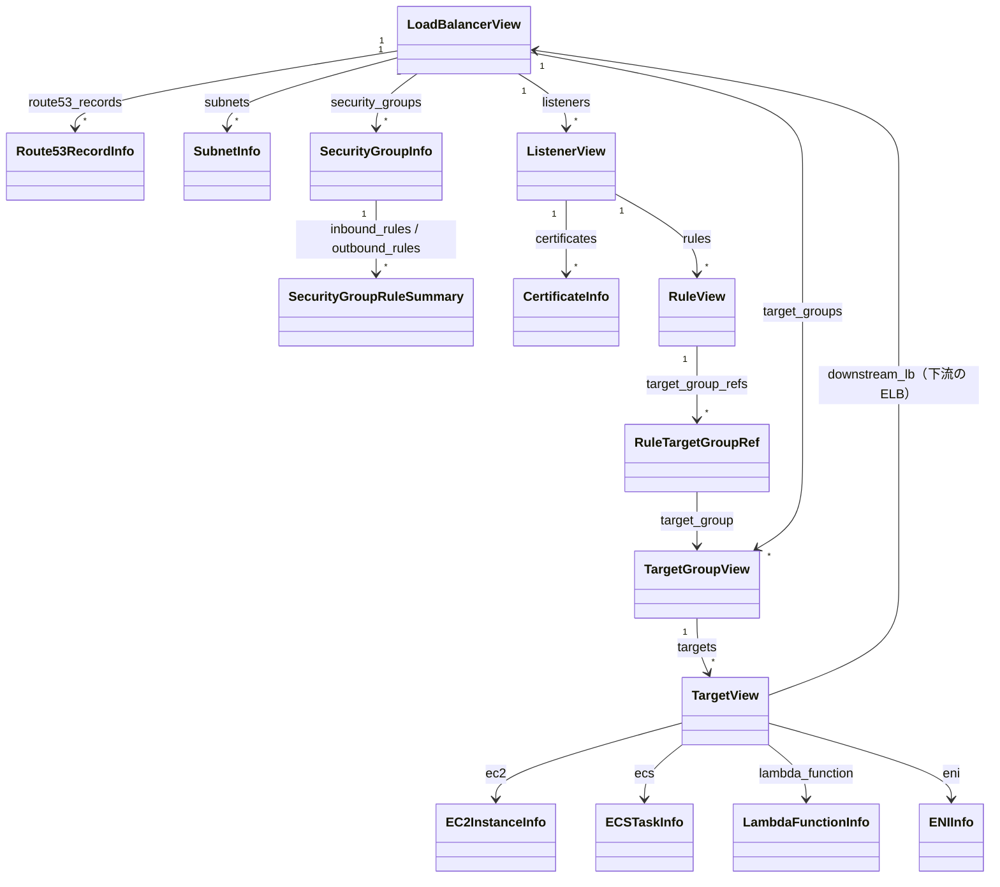
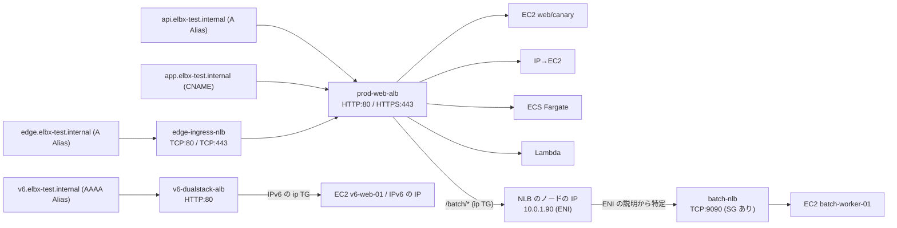

<div align="center">

# elbx

**AWS の ALB / NLB の構成を、その先のターゲットが EC2・ECS・Lambda などのどれなのかまで 1 コマンドで確かめられる、参照専用の CLI & Python ライブラリ**

[](https://github.com/gyuro-dev/elbx/actions/workflows/ci.yml)
[](LICENSE)


[](#-ai-で開発しています)

[English](https://github.com/gyuro-dev/elbx/blob/main/README.md) | 日本語

[できること](#-できること) ・ [クイックスタート](#-クイックスタート) ・ [使い方](#-使い方) ・ [詳しい情報](#-詳しい情報)

</div>

---

**elbx** は、AWS の ELB（ALB / NLB）を 1 コマンドで調べるツールです。\
リスナー → ルール → ターゲットグループ → ターゲットをまとめて取得し、ターゲットが EC2・ECS・Lambda・別の ELB のどれなのかまで突き合わせて、1 つのツリーで見せます。

```text
$ elbx tree prod-web-alb
[APPLICATION] prod-web-alb (internet-facing, active)
│  api.elbx-test.internal, app.elbx-test.internal
├── HTTP:80
│   ├── [10] Path /health-http
│   │   └── prod-web-tg [2/2 healthy]
│   │       ├── ● web-prod-01
│   │       └── ● web-prod-02
│   └── [default]
│       └── Redirect (HTTP_301) -> HTTPS://#{host}:443/#{path}
└── HTTPS:443  cert=*.elbx-test.internal
    ├── [10] Host api.elbx-test.internal AND Path /v1/*
    │   ├── prod-web-tg (weight=90) [2/2 healthy]
    │   │   ├── ● web-prod-01
    │   │   └── ● web-prod-02
    │   └── prod-canary-tg (weight=10) [1/1 healthy]
    │       └── ● canary-prod-01
    ├── [20] Header(X-Env) ip-direct AND Method GET, POST AND Query mode=fast AND SourceIP 203.0.113.0/24
    │   └── prod-ip-tg [1/1 healthy]
    │       └── ● web-prod-01 (ip)
    ├── [25] Path /ecs/*
    │   └── prod-ecs-tg [1/1 healthy]
    │       └── ● ECS prod-ecs-cluster/api-fargate-svc
    ├── [28] Path /auth/*
    │   └── prod-lambda-tg [0/1 healthy, 1 unavailable]
    │       └── ○ Lambda prod-auth-fn (unavailable)
    ├── [29] Path /batch/*
    │   └── alb-to-nlb-tg [1/1 healthy]
    │       └── ● NLB batch-nlb (10.0.1.90)
    │           └── TCP:9090
    │               └── [default]
    │                   └── batch-nlb-tg [1/1 healthy]
    │                       └── ● batch-worker-01
    ├── [30] Path /legacy/*
    │   └── Redirect (HTTP_301) -> HTTPS://new.elbx-test.internal:443/modern
    ├── [40] Path /maintenance
    │   └── FixedResponse (503, text/plain)
    └── [default]
        └── prod-web-tg [2/2 healthy]
            ├── ● web-prod-01
            └── ● web-prod-02
```

「このリクエストはどのルールに一致して、どこへ届くか」も、設定から確かめられます（リクエストは送りません）。

```text
$ elbx route https://api.elbx-test.internal/v1/users
GET https://api.elbx-test.internal/v1/users

入口: [APPLICATION] prod-web-alb (Listener HTTPS:443)
  ✓ Rule [priority:10] IF Host in [api.elbx-test.internal] AND Path in [/v1/*]
      Host 'api.elbx-test.internal' は [api.elbx-test.internal] に一致
      Path '/v1/users' は [/v1/*] に一致
  => Forward -> prod-web-tg (weight=90), prod-canary-tg (weight=10)
     TG: prod-web-tg (weight=90) [2/2 healthy]
       - [● healthy] web-prod-01 (i-a1796bfc1e2ae544c) port=8080
       - [● healthy] web-prod-02 (i-11010942aa540fd4e) port=8080
     TG: prod-canary-tg (weight=10) [1/1 healthy]
       - [● healthy] canary-prod-01 (i-fffcc4ca948f4933a) port=8080
```

- 🔒 **参照専用**: 読み取りの API だけを呼び、AWS のリソースを変更しません
- 📦 **依存は boto3 だけ**: ツリーや表の描画、CLI は Python の標準ライブラリだけで作っています

> 出力例は、リポジトリのテスト用の構成（`tests/data/infra.yaml`）で実行したものです。

## ✨ できること

| | 機能 | コマンド |
| :-: | :--- | :--- |
| 🌳 | ELB → リスナー → ルール → TG → ターゲットを **1 つのツリー**で表示。既定は短い関連図、`--full` で Route 53・SG・サブネット・証明書・属性・ターゲットの詳細まで | `elbx tree` |
| 🔎 | ターゲットの **正体を特定**: EC2 / ECS（Fargate・bridge）/ Lambda / IP 登録（ENI）/ 下流の ELB（NLB → ALB、ALB → NLB）。IPv4・デュアルスタック・IPv6 only のどれでも | `elbx tree` / `targets` |
| 🧭 | リクエストが **どのルールに一致してどこへ届くか**を、条件ごとの一致・不一致の理由つきで評価（多段の ELB もたどる） | `elbx route` |
| 🚨 | 全 ELB を横断して **調べるべきターゲットだけ**を、理由とヘルスチェック設定つきで一覧表示 | `elbx targets --unhealthy` |
| 🔁 | EC2 の Name・IP・ECS サービス名・Lambda 関数名・ELB 名から、**どの ELB / TG に登録されているか**を逆引き | `elbx find` |
| 🐍 | CLI が表示する情報はすべて、Python から **型付きのオブジェクト**で取り出せます | `ELBClient` |

## 🚀 クイックスタート

```bash
uv tool install elbx    # または pipx install elbx
```

Python からも使うときは、プロジェクトに入れてください: `uv add elbx` か `pip install elbx`。

```bash
elbx ls                                              # ELB の一覧
elbx tree my-alb                                     # 1 つの ELB をツリーで
elbx route https://api.example.org/v1/users          # このリクエストがどこへ届くか
elbx targets --unhealthy                             # 調べるべきターゲットだけ
elbx find web-01                                     # この EC2 はどの ELB に登録されている？
```

認証情報は AWS CLI と同じもの（環境変数・`~/.aws/config`・SSO など）を使います。\
プロファイルとリージョンは `--profile` / `--region` で指定します。

出力の言語は英語か日本語で、指定しなければ OS の言語に合わせます（[言語](#言語)を参照）。

> [!TIP]
> AWS アカウントがなくても、手元の擬似環境（[moto](https://github.com/getmoto/moto)）で出力を試せます: `uv run python playground.py`（[詳しい情報](#-詳しい情報)の「開発者向け」を参照）

## 📖 使い方

> 長い出力は折りたたんであります（▶ で開きます）。

### `elbx tree` — ELB の全体をツリーで見る

ELB → リスナー → ルール → 転送先の TG（重みつき）→ ターゲットを 1 つのツリーで表示します。\
既定は **関連図** で、ルールの条件、TG のヘルス集計、ターゲットの名前だけを短い行で出します。\
各 TG では healthy 以外を先に、unhealthy は赤、draining と initial は黄色で出すので、問題のあるターゲットがすぐ見つかります。
`--full` を付けると、Route 53 のレコード、SG のルール、サブネット、証明書、ELB / TG の属性、ターゲットの詳細（IP・AZ・インスタンスタイプなど）まで出ます。

```bash
elbx tree prod-web-alb                         # 1 つの ELB の関連図
elbx tree                                      # 全 ELB
elbx tree -s prod                              # 名前に prod を含む ELB
elbx tree prod-web-alb --full                  # 属性・SG・サブネット・ターゲットの詳細まで全部
elbx tree prod-web-alb --full --no-network --no-dns   # 全部出しから SG・サブネット・Route 53 を省いて速く
elbx tree prod-web-alb --json > alb.json       # 全情報を JSON で
```

<details>
<summary>出力例: <code>elbx tree prod-web-alb</code>（障害があるとき。healthy 以外のターゲットが先に出ます）</summary>

```text
[APPLICATION] prod-web-alb (internet-facing, active)
│  api.elbx-test.internal, app.elbx-test.internal
├── HTTP:80
│   ├── [10] Path /health-http
│   │   └── prod-web-tg [1/2 healthy, 1 unhealthy]
│   │       ├── ✖ web-prod-02 (unhealthy)
│   │       └── ● web-prod-01
│   └── [default]
│       └── Redirect (HTTP_301) -> HTTPS://#{host}:443/#{path}
└── HTTPS:443  cert=*.elbx-test.internal
    ├── [10] Host api.elbx-test.internal AND Path /v1/*
    │   ├── prod-web-tg (weight=90) [1/2 healthy, 1 unhealthy]
    │   │   ├── ✖ web-prod-02 (unhealthy)
    │   │   └── ● web-prod-01
    │   └── prod-canary-tg (weight=10) [0/1 healthy, 1 draining]
    │       └── ◐ canary-prod-01 (draining)
    ├── [20] Header(X-Env) ip-direct AND Method GET, POST AND Query mode=fast AND SourceIP 203.0.113.0/24
    │   └── prod-ip-tg [1/1 healthy]
    │       └── ● web-prod-01 (ip)
    ├── [25] Path /ecs/*
    │   └── prod-ecs-tg [1/1 healthy]
    │       └── ● ECS prod-ecs-cluster/api-fargate-svc
    ├── [28] Path /auth/*
    │   └── prod-lambda-tg [0/1 healthy, 1 initial]
    │       └── ◐ Lambda prod-auth-fn (initial)
    ├── [29] Path /batch/*
    │   └── alb-to-nlb-tg [1/1 healthy]
    │       └── ● NLB batch-nlb (10.0.1.90)
    │           └── TCP:9090
    │               └── [default]
    │                   └── batch-nlb-tg [1/1 healthy]
    │                       └── ● batch-worker-01
    ├── [30] Path /legacy/*
    │   └── Redirect (HTTP_301) -> HTTPS://new.elbx-test.internal:443/modern
    ├── [40] Path /maintenance
    │   └── FixedResponse (503, text/plain)
    └── [default]
        └── prod-web-tg [1/2 healthy, 1 unhealthy]
            ├── ✖ web-prod-02 (unhealthy)
            └── ● web-prod-01
```

</details>

<details>
<summary>出力例: <code>elbx tree prod-web-alb --full</code>（一部省略）</summary>

```text
[APPLICATION] prod-web-alb (internet-facing, state=active, vpc=vpc-e9cb8defe2411ab19)
│  DNS: prod-web-alb-1.ap-northeast-1.elb.amazonaws.com
│  Route53: api.elbx-test.internal (A Alias, zone=elbx-test.internal [Private]), app.elbx-test.internal (CNAME, zone=elbx-test.internal [Private])
│  Attributes: cross_zone=off, deletion_protection=off
├── Network & Security
│   ├── Subnets (2 AZs)
│   │   ├── ap-northeast-1a: subnet-9f75c2c3f85f6074d (public-subnet-1a) [10.0.1.0/24, 2001:db8:1:1::/64]
│   │   └── ap-northeast-1c: subnet-98d07c497a9e06c85 (public-subnet-1c) [10.0.2.0/24, 2001:db8:1:2::/64]
│   └── Security Groups (1)
│       └── sg-d820c3c652b9103b9 (prod-alb-sg)
│           ├── in  allow TCP:443 from 10.0.0.0/16 # HTTPS from VPC
│           ├── in  allow ALL:ALL from 10.0.0.0/16 # All VPC internal
│           └── out allow ALL:ALL to 0.0.0.0/0
└── Listeners (2)
    ├── Listener HTTP:80
    │   └── Rule [default] IF DEFAULT (すべての未一致リクエスト)
    │       └── Redirect (HTTP_301) -> HTTPS://#{host}:443/#{path}
    └── Listener HTTPS:443 [SSLPolicy: ELBSecurityPolicy-TLS13-1-2-2021-06]
        ├── ACM Cert: *.elbx-test.internal (4c046ae0-ef28-4bf3-bab6-6ec32d540239, status=PENDING_VALIDATION, expires=2027-10-17)
        ├── Rule [priority:10] IF Host in [api.elbx-test.internal] AND Path in [/v1/*]
        │   ├── TG: prod-web-tg (weight=90) (HTTP:8080, type=instance, HC=HTTP:traffic-port/healthz) [2/2 healthy]
        │   │   ├── attrs: dereg_delay=300s
        │   │   ├── [● healthy] web-prod-01 [id=i-88c6e44c0bb0ea3e6, port=8080, ip=10.0.1.11, az=ap-northeast-1a, type=t3.medium, ec2=running]
        │   │   │   └── net: subnet=public-subnet-1a (subnet-9f75c2c3f85f6074d, 10.0.1.0/24, 2001:db8:1:1::/64) | sg=prod-alb-sg (sg-d820c3c652b9103b9)
        │   │   └── [● healthy] web-prod-02 [id=i-f75dd6e70a2a90cf1, port=8080, ip=10.0.2.12, az=ap-northeast-1c, type=t3.medium, ec2=running]
        │   └── TG: prod-canary-tg (weight=10) (HTTP:8080, type=instance, HC=HTTP:traffic-port/healthz) [1/1 healthy]
        │       └── [● healthy] canary-prod-01 [id=i-f35eac4266f7e9663, port=8080, ip=10.0.1.21, az=ap-northeast-1a, type=t3.small, ec2=running]
        ├── Rule [priority:25] IF Path in [/ecs/*]
        │   └── TG: prod-ecs-tg (HTTP:9000, type=ip, HC=HTTP:traffic-port/ecs-health) [1/1 healthy]
        │       └── [● healthy] [ECS:FARGATE] prod-ecs-cluster/api-fargate-svc [port=9000, ip=10.0.1.60, container=api-container, def=api-fargate-task:1, az=ap-northeast-1a]
        ├── Rule [priority:28] IF Path in [/auth/*]
        │   └── TG: prod-lambda-tg (type=lambda) [0/1 healthy, 1 unavailable]
        │       └── [○ unavailable] [Lambda] prod-auth-fn [runtime=python3.12, handler=index.handler, state=Active] (Target.HealthCheckDisabled: Health checks are not enabled for this target)
        ├── Rule [priority:29] IF Path in [/batch/*]
        │   └── TG: alb-to-nlb-tg (HTTP:9090, type=ip, HC=HTTP:traffic-port/) [1/1 healthy]
        │       └── [● healthy] [IP->NLB] batch-nlb [port=9090, ip=10.0.1.90, az=ap-northeast-1a, eni=eni-09d063400d2fadc20, scheme=internal, ...]
        │           └── Listeners (1)
        │               └── Listener TCP:9090
        │                   └── Rule [default] IF DEFAULT (すべての未一致リクエスト)
        │                       └── TG: batch-nlb-tg (TCP:9090, type=instance, HC=TCP:traffic-port) [1/1 healthy]
        │                           └── [● healthy] batch-worker-01 [id=i-9bf2f3b2796585bf5, port=9090, ip=10.0.1.71, az=ap-northeast-1a, ...]
        ├── Rule [priority:40] IF Path in [/maintenance]
        │   └── FixedResponse (503, text/plain)
        └── ...
```

</details>

| 引数・オプション | 既定値 | 説明 |
| :--- | :--- | :--- |
| `NAME_OR_ARN` | 全 ELB | 表示する ELB の名前か ARN。`--search` とは併用できません。見つからなければエラー（終了コード `1`）です。 |
| `-s`, `--search WORD` | なし | 名前か DNS 名に `WORD` を含む ELB だけ（大文字小文字は区別しない）。`NAME_OR_ARN` とは併用できません。一致がなければ「ロードバランサーが見つかりませんでした。」と出て、終了コードは `0` です。 |
| `-f`, `--full` | 関連図 | すべて出します: Route 53 レコードの種類とゾーン、ELB / TG の属性、サブネットと SG のルール、証明書の期限、ターゲットごとの ID・IP・AZ・インスタンスタイプ・サブネット・SG。省略時の関連図は、リスナー・ルール（優先度と条件）・TG（ヘルス集計）・ターゲットの名前だけで、サブネット・SG を取得しないぶん速く終わります。 |
| `--max-targets N` | `10` | 関連図で 1 つの TG に名前を出すターゲットの数。超えた分は `… ほか N 台 (healthy)` の 1 行にまとめ、healthy 以外は数に関係なく出します。`0` で全部出します。`--full` では使いません。 |
| `--no-network` | 取得する | `--full` のとき、ELB とターゲットのサブネット・SG を取得しません。「Network & Security」とターゲットの下の `net:` 行がなくなり、API の呼び出しが減るぶん速くなります。 |
| `--no-dns` | 取得する | Route 53 のホストゾーンを走査せず、`Route53:` 行を出しません。ゾーンやレコードが多くて遅いときに使います。 |
| `--json` | テキスト | ツリーと同じ内容を JSON（ELB の配列）で出力します。すべての属性やルールの条件（`condition_specs`）など、ツリーには出ない項目も含みます。 |

---

### `elbx route` — リクエストがどこへ届くかを確かめる

リクエストがどのリスナールールに一致し、どの TG・ターゲットへ届くかを、設定から評価します（リクエストは送りません）。\
ルールは優先度の順に評価し、一致しなかったルールには理由を付けます。\
NLB → ALB のような多段構成も、下流の ELB まで続けて評価します。

```bash
elbx route https://api.elbx-test.internal/v1/users
elbx route https://edge.elbx-test.internal/auth/login                 # NLB から入って下流の ALB までたどる
elbx route "https://api.elbx-test.internal/x?mode=fast" -X POST -H "X-Env: ip-direct" --source-ip 203.0.113.10
elbx route https://new-host.example.org/ --lb prod-web-alb            # DNS に登録する前のホスト名を試す
```

<details>
<summary>出力例: <code>elbx route https://edge.elbx-test.internal/auth/login</code></summary>

```text
GET https://edge.elbx-test.internal/auth/login

入口: [NETWORK] edge-ingress-nlb (Listener TCP:443)
  ✓ Rule [default] IF DEFAULT (すべての未一致リクエスト)
      どのルールにも一致しなかったため default を適用
  => Forward -> nlb-to-alb-tg
     TG: nlb-to-alb-tg [1/1 healthy]
    ↓ 転送先: [APPLICATION] prod-web-alb (Listener HTTPS:443)
      ✗ Rule [priority:10] IF Host in [api.elbx-test.internal] AND Path in [/v1/*]
          Host 'edge.elbx-test.internal' は [api.elbx-test.internal] のいずれにも一致しません
          Path '/auth/login' は [/v1/*] のいずれにも一致しません
      ✗ Rule [priority:20] IF Header(X-Env) in [ip-direct] AND Method in [GET, POST] AND Query in [mode=fast] AND SourceIP in [203.0.113.0/24]
          Header(X-Env) がリクエストにありません（-H で指定できます）
          Query '(なし)' は [mode=fast] のいずれにも一致しません
          送信元IPが未指定のため不一致として扱いました（--source-ip で指定できます）
      ✗ Rule [priority:25] IF Path in [/ecs/*]
          Path '/auth/login' は [/ecs/*] のいずれにも一致しません
      ✓ Rule [priority:28] IF Path in [/auth/*]
          Path '/auth/login' は [/auth/*] に一致
      => Forward -> prod-lambda-tg
         TG: prod-lambda-tg [0/1 healthy, 1 unavailable]
           - [○ unavailable] Lambda:prod-auth-fn port=- (Target.HealthCheckDisabled)
```

</details>

<details>
<summary>出力例: <code>elbx route "https://api.elbx-test.internal/x?mode=fast" -X POST -H "X-Env: ip-direct" --source-ip 203.0.113.10</code></summary>

```text
POST https://api.elbx-test.internal/x?mode=fast

入口: [APPLICATION] prod-web-alb (Listener HTTPS:443)
  ✗ Rule [priority:10] IF Host in [api.elbx-test.internal] AND Path in [/v1/*]
      Path '/x' は [/v1/*] のいずれにも一致しません
  ✓ Rule [priority:20] IF Header(X-Env) in [ip-direct] AND Method in [GET, POST] AND Query in [mode=fast] AND SourceIP in [203.0.113.0/24]
      Header(X-Env) 'ip-direct' は [ip-direct] に一致
      Method 'POST' は [GET, POST] に一致
      Query 'mode=fast' は [mode=fast] に一致
      SourceIP '203.0.113.10' は [203.0.113.0/24] に一致
  => Forward -> prod-ip-tg
     TG: prod-ip-tg [1/1 healthy]
       - [● healthy] web-prod-01 (10.0.1.11) port=9000
```

</details>

| 引数・オプション | 既定値 | 説明 |
| :--- | :--- | :--- |
| `URL` | （必須） | リクエストの URL（`https://ホスト[:ポート]/パス?クエリ`）。スキームを省くと `http`、ポートを省くと `http` は 80、`https` は 443 のリスナーを評価します。ホストは小文字にして照合し、パスとクエリは条件の評価に使います。 |
| `--lb NAME_OR_ARN` | ホスト名から探す | 入口の ELB の名前か ARN。省略すると、ホスト名に一致する ELB の DNS 名 → Route 53 のレコード（完全一致 → ワイルドカード。同じゾーンにそのホスト名のレコードがあればワイルドカードは使わず、読むのはホスト名かその親ドメインの名前のホストゾーンだけ）の順に探し、なければエラーです。DNS に登録する前のホスト名を試すときや、入口を決め打ちするときに指定します。 |
| `-X`, `--method METHOD` | `GET` | HTTP メソッド（`http-request-method` 条件に使います）。ALB と同じく大文字小文字を区別するので（`post` は `POST` に一致しない）、大文字で書きます。 |
| `-H`, `--header 'NAME: VALUE'` | なし | リクエストヘッダー（複数可）。`http-header` 条件に使い、名前・値とも大文字小文字を区別しません。指定していないヘッダーを条件に持つルールは不一致になり、理由にそう出ます。`Host` を指定すると、`host-header` 条件はその値（ポートを除く）で評価します（指定しなければ URL のホスト名）。 |
| `--source-ip IP` | なし | 送信元の IP アドレス（IPv4 / IPv6。`source-ip` 条件に使います）。省略すると `source-ip` 条件を持つルールは不一致になります。IP でない値はエラーです。 |
| `--json` | テキスト | 結果を JSON で出力します: 評価したルールと理由（`evaluations`）、一致したルール（`matched_rule_priority`）、アクション、転送先の TG（重み・ヘルス・ターゲット）、下流の ELB（`downstream`）、評価が止まった理由（`note` と、プログラム向けの `note_code`: `no_listener` / `no_matching_rule` / `too_many_hops`）。 |

<details>
<summary>評価のルール（ALB の仕様に合わせています）</summary>

- ルールは優先度の小さい順に評価し、最初に一致したルールで止まります。どれにも一致しなければ default ルールです
- ルールの中の条件は AND、条件の中の値は OR です。ワイルドカードは `*`（0 文字以上）と `?`（1 文字）です（`query-string` 条件では `\*`・`\?` でその文字そのもの）
- ホスト・HTTP ヘッダー・クエリ文字列は大文字小文字を区別せず、パスと HTTP メソッドは区別します
- クエリ文字列は、全体の `%XX` をデコードしてから `&` と `=` で分けて照合します（`+` は空白にせず `+` のまま）。キーのない `query-string` 条件は、デコード前のクエリ文字列の全体と照合します
- パスは、`%XX` をデコードし（`%2F` も `/` になります）、`.` と `..` の部分を取り除いてから照合します
- 一致したルールの転送先 TG に別の ELB が登録されていれば、その ELB の、ターゲットのポートと同じポートのリスナーで続けて評価します。対象は、NLB の `alb` タイプの TG に登録された ALB と、ip タイプの TG に IP で登録された ELB のノードです
- 重み 0 の TG にはリクエストが届かないので、TG の行に `(リクエストは届きません)` と書き、ターゲットと下流の ELB はたどりません
- 認証のアクション（Cognito / OIDC）があるルールは、認証が通ったものとして、その先の転送を評価します
- 評価するのはリスナールールだけです。SG・NACL・ルートテーブルで通信が通るかは判定しません

</details>

---

### `elbx targets` — ターゲットの一覧・障害時の確認

TG ごとのターゲットを 1 行ずつ、種別・正体・IP・AZ・サブネット・SG・ヘルスつきで一覧にします。
`--unhealthy` で、全 ELB を横断して調べるべきターゲットだけを、理由とヘルスチェック設定つきで並べます。\
障害のときは、まずこれでどのターゲットに問題があるかを見ます。

```bash
elbx targets --unhealthy            # 調べるべきターゲットだけ（全 ELB を横断）
elbx targets prod-web-alb           # ELB で絞り込み
elbx targets --tg prod-web-tg       # TG で絞り込み
elbx targets -s api --unhealthy     # 名前に api を含む TG だけ
elbx targets                        # すべての TG（ELB に紐づかない TG も含む）
```

<details>
<summary>出力例: <code>elbx targets --unhealthy</code>（障害が起きている状態）</summary>

```text
TARGET GROUP    KIND    TARGET ID            RESOURCE / NAME                    ...  ELB HEALTH  STATE    REASON                           DETAIL                                        HEALTH CHECK
--------------  ------  -------------------  ---------------------------------  ...  ----------  -------  -------------------------------  --------------------------------------------  ------------------------------------------------------------------------------
prod-canary-tg  ec2     i-f35eac4266f7e9663  canary-prod-01                     ...  draining    running  Target.DeregistrationInProgress  Target deregistration is in progress          HTTP:traffic-port/healthz 200 every 30s (timeout 5s, unhealthy x2, healthy x5)
prod-lambda-tg  lambda  arn:aws:lambda:...   Lambda: prod-auth-fn (python3.12)  ...  initial     Active   Elb.RegistrationInProgress       Target registration is in progress            -
prod-web-tg     ec2     i-f75dd6e70a2a90cf1  web-prod-02                        ...  unhealthy   running  Target.FailedHealthChecks        Health checks failed with these codes: [502]  HTTP:traffic-port/healthz 200 every 30s (timeout 5s, unhealthy x2, healthy x5)
```

（`...` はプライベート IP・ポート・AZ・サブネット・SG の列）

</details>

<details>
<summary>出力例: <code>elbx targets prod-web-alb</code></summary>

```text
TARGET GROUP    KIND    TARGET ID            RESOURCE / NAME                        PRIVATE IP  PORT  AZ               SUBNET                                       SECURITY GROUPS                      ELB HEALTH  STATE    REASON
--------------  ------  -------------------  -------------------------------------  ----------  ----  ---------------  -------------------------------------------  -----------------------------------  ----------  -------  ------
alb-to-nlb-tg   nlb     10.0.1.90            NLB: batch-nlb                         10.0.1.90   9090  ap-northeast-1a  public-subnet-1a (subnet-9f75c2c3f85f6074d)  batch-nlb-sg (sg-fd0e3a203cd6895b8)  healthy     active   -
prod-ecs-tg     ecs     10.0.1.60            ECS: prod-ecs-cluster/api-fargate-svc  10.0.1.60   9000  ap-northeast-1a  public-subnet-1a (subnet-9f75c2c3f85f6074d)  prod-alb-sg (sg-d820c3c652b9103b9)   healthy     ACTIVE   -
prod-ip-tg      ec2     10.0.1.11            web-prod-01                            10.0.1.11   9000  ap-northeast-1a  public-subnet-1a (subnet-9f75c2c3f85f6074d)  prod-alb-sg (sg-d820c3c652b9103b9)   healthy     running  -
prod-web-tg     ec2     i-88c6e44c0bb0ea3e6  web-prod-01                            10.0.1.11   8080  ap-northeast-1a  public-subnet-1a (subnet-9f75c2c3f85f6074d)  prod-alb-sg (sg-d820c3c652b9103b9)   healthy     running  -
```

</details>

| 引数・オプション | 既定値 | 説明 |
| :--- | :--- | :--- |
| `LB` | すべての TG | ELB の名前か ARN。その ELB の TG だけを表示します。省略すると（`--tg` もなければ）、ELB に紐づいていない TG も含めて全 TG です。 |
| `--tg TG` | - | この TG（名前か ARN）だけ。`LB` とは併用できません。 |
| `-s`, `--search TEXT` | - | 名前にこの文字列を含む TG だけ（大文字小文字は区別しない）。`LB` とは併用でき、`--tg` とはできません。 |
| `--unhealthy` | すべて表示 | 調べるべきターゲットだけに絞ります。対象は healthy 以外（`unhealthy` / `draining` / `initial` / `unused` / `unavailable`）のうち、設定上そうなるものを除いたターゲットです。除くのは、ヘルスチェックを無効にした TG の `unavailable`（`Target.HealthCheckDisabled`。Lambda の TG の既定）と、どの ELB にも使われていない TG の `unused` です。ELB に使われている TG の停止中のインスタンス（`unused`）は出します。`DETAIL`（状態の説明）と `HEALTH CHECK`（プロトコル・ポート・パス・成功コード・間隔・タイムアウト・閾値）の列が加わります。該当がなければ「調べるべきターゲットはありません。」と出ます。`--json` も同じように絞られます（`summary` は絞る前の、TG 全体の件数です）。 |
| `--json` | テキスト | TG の配列を JSON で出力します: ヘルスチェック設定、属性、件数の集計（`summary`。状態ごとの `by_state` と調べるべき数 `attention`）、各ターゲットの詳細（EC2 / ECS / Lambda / ENI / 下流の ELB）。 |

`KIND` 列はターゲットの正体（`ec2` / `ecs` / `lambda` / `alb` / `nlb` / `eni` / `ip`）、\
`STATE` 列はその正体の状態（EC2 の `running`、ECS の `RUNNING`、ELB の `active` など）です。

---

### `elbx find` — どの ELB に登録されているかを逆引きする

EC2 やコンテナ、Lambda、ELB の名前・ID・IP から、それがどの ELB のどの TG に登録されているかを探します。

```bash
elbx find web-prod-01        # EC2 の Name タグ
elbx find 10.0.1.11          # プライベート IP
elbx find api-fargate-svc    # ECS のサービス名（クラスター名・タスク ID でも可）
elbx find prod-auth-fn       # Lambda の関数名
elbx find batch-nlb          # NLB 名 → その NLB のノードの IP を登録している ALB と TG
```

<details>
<summary>出力例: <code>elbx find web-prod-01</code></summary>

```text
LOAD BALANCER  TARGET GROUP  KIND  TARGET ID            RESOURCE / NAME  PRIVATE IP  PORT  ELB HEALTH  STATE
-------------  ------------  ----  -------------------  ---------------  ----------  ----  ----------  -------
prod-web-alb   prod-ip-tg    ec2   10.0.1.11            web-prod-01      10.0.1.11   9000  healthy     running
prod-web-alb   prod-web-tg   ec2   i-88c6e44c0bb0ea3e6  web-prod-01      10.0.1.11   8080  healthy     running
```

</details>

| 引数・オプション | 既定値 | 説明 |
| :--- | :--- | :--- |
| `QUERY` | （必須） | 探す文字列。大文字小文字を区別しない **部分一致** です（IP アドレスだけは全体で一致）。照合する項目: EC2 の Name / インスタンス ID / プライベート IP / パブリック IP、ECS のクラスター名 / サービス名 / タスク ID / タスク定義 / コンテナ名、Lambda の関数名 / ARN、下流の ELB の名前 / ARN / DNS 名、ENI の ID / 説明（ELB のノードの ENI なら ELB 名でも当たる）、ターゲット ID。ARN は名前の部分（関数名、ELB の名前と ID）だけと照合するので、リージョン名やアカウント ID では当たりません（ARN 全体で探すには `arn:` から書きます）。空文字はエラーです。 |
| `--json` | テキスト | 結果の配列を JSON で出力します（ELB・TG・ターゲットの詳細を含む）。 |

- 1 つのターゲットが複数の ELB や TG に登録されていれば、その数だけ行が出ます（`web-prod-01` は instance 登録と ip 登録の 2 行）
- 部分一致なので、`web-prod` では `web-prod-01` と `web-prod-02` の両方が出ます。1 台に絞るには、インスタンス ID か IP で探します
- IP アドレスは全体でしか一致しないので、`elbx find 10.0.1` では見つかりません（IP の一部に見える文字列なら、ヒントでそう伝えます）
- ELB に紐づいていない TG のターゲットは、`LOAD BALANCER` 列が `(ELB未アタッチ)` になります

---

### `elbx ls` — ELB の一覧

ELB ごとに、種類・スキーム・状態・リスナー・ヘルスの集計・Route 53 のレコード名を 1 行で出します。\
調べるべきターゲットがあれば、`TARGETS` 列にその数を赤で添えます（`4/7 (6 TGs, 要確認: 3)`）。ヘルスチェックが無効な Lambda のように、設定どおりの状態は数えません。\
表に出さない情報（ターゲットの正体・証明書・属性・サブネット・SG）は取得しないので、`--json` より速く終わります。

```bash
elbx ls
elbx ls -s batch
```

<details>
<summary>出力例: <code>elbx ls</code></summary>

```text
NAME              TYPE         SCHEME                STATE   VPC                    LISTENERS           TARGETS (HEALTHY/TOTAL)  ROUTE53 / DNS NAME
----------------  -----------  --------------------  ------  ---------------------  ------------------  -----------------------  -------------------------------------------------------------------------------------------------
prod-web-alb      application  internet-facing       active  vpc-a4f21b708b96d5be5  HTTP:80, HTTPS:443  6/7 (6 TGs)              api.elbx-test.internal, app.elbx-test.internal -> prod-web-alb-1.ap-northeast-1.elb.amazonaws.com
edge-ingress-nlb  network      internal              active  vpc-a4f21b708b96d5be5  TCP:80, TCP:443     1/1 (1 TGs)              edge.elbx-test.internal -> edge-ingress-nlb-1.ap-northeast-1.elb.amazonaws.com
batch-nlb         network      internal              active  vpc-a4f21b708b96d5be5  TCP:9090            1/1 (1 TGs)              batch-nlb-1.ap-northeast-1.elb.amazonaws.com
v6-dualstack-alb  application  internal (dualstack)  active  vpc-a4f21b708b96d5be5  HTTP:80             3/3 (1 TGs)              v6.elbx-test.internal -> v6-dualstack-alb-1.ap-northeast-1.elb.amazonaws.com
```

</details>

| オプション | 既定値 | 説明 |
| :--- | :--- | :--- |
| `-s`, `--search WORD` | なし | 名前か DNS 名に `WORD` を含む ELB だけ（大文字小文字は区別しない）。 |
| `--no-dns` | 取得する | Route 53 のホストゾーンを走査しません。`ROUTE53 / DNS NAME` 列は DNS 名だけになります。 |
| `--json` | テキスト | ELB の配列を JSON で出力します。表では省くサブネット・SG も取得して含めます。 |

---

### JSON をほかのツールにつなぐ

すべてのコマンドに `--json` があります。

```bash
# healthy 以外のターゲットの名前と理由だけを取り出す
elbx targets --unhealthy --json | jq -r '.[].targets[] | "\(.display_name)\t\(.health_reason)"'

# このパスはどの TG に重み何 % で振られる？
elbx route https://api.elbx-test.internal/v1/users --json | jq '.entries[0].target_groups[] | {name, weight}'
```

### Python から使う

CLI が表示する情報はすべて dataclass で取り出せます。\
表示の文字列を解析する必要はありません。

```python
from elbx import ELBClient, print_lb_tree

client = ELBClient(profile_name="my-profile", region_name="ap-northeast-1")

lb = client.get_load_balancer("prod-web-alb")
print_lb_tree(lb)  # CLI の tree --full と同じ表示（関連図は format_lb_map(lb)）

for t in lb.all_targets:  # 種別を問わず同じ書き方で参照できる
    print(t.target_kind, t.display_name, t.ip_address, t.availability_zone, t.health_state)

result = client.simulate_request("https://api.elbx-test.internal/v1/users")
hop = result.entries[0]
if hop.matched_rule:  # 何も評価できなかったときは None（理由は hop.note_code: "no_listener" など）
    print(hop.matched_rule.actions_summary)
# ['Forward -> prod-web-tg (weight=90), prod-canary-tg (weight=10)']
```

型の情報（`py.typed`）が付いているので、この README の例はそのまま `mypy --strict` を通ります。

ほかの使い方は[詳しい情報](#-詳しい情報)の「Python API リファレンス」と「レシピ集」にあります。

---

### 全コマンド共通のオプション

| オプション | 既定値 | 説明 |
| :--- | :--- | :--- |
| `-p`, `--profile NAME` | AWS CLI と同じ（`AWS_PROFILE` → `default`） | AWS のプロファイル。SSO のプロファイルも使えます（先に `aws sso login --profile NAME`）。 |
| `-r`, `--region REGION` | プロファイルの設定（または `AWS_REGION`） | 調べるリージョン。1 回の実行で見られるのは 1 リージョンだけです。 |
| `-j`, `--workers N` | `10` | AWS API を同時に呼ぶ数（コマンド全体での上限）。大きいほど速い一方、呼び出し制限（`Rate exceeded`）にかかりやすくなります。制限にかかった呼び出しは最大 10 回やり直します（環境変数 `AWS_RETRY_MODE`・`AWS_MAX_ATTEMPTS` があればその値）。`1` なら 1 つずつ呼びます。botocore の知らないリージョン名（打ち間違いなど）のときは、やり直しを 2 回までにして、すぐにエラーにします。 |
| `--color` / `--no-color` | 端末への出力なら色あり | `--color` は端末でなくても色を付け（`less -R` へのパイプ、CI のログなど）、`--no-color` は付けません。どちらもなければ、ファイルやパイプへの出力は色なしです。環境変数 `FORCE_COLOR` / `NO_COLOR` も同じ働きです（両方あれば `FORCE_COLOR`）。 |
| `-v`, `--verbose` | なし | 詳細を標準エラー出力に出します。`-v` は取得できなかったものとその理由、`-vv` はさらに AWS API の呼び出しと所要時間（[ログ](#ログ)を参照）。 |
| `--lang en\|ja` | `ELBX_LANG`、なければ OS の言語 | ヘルプ・メッセージ・出力のラベルの言語（[言語](#言語)を参照）。 |

- 共通オプションは、サブコマンドの前（`elbx --profile prod tree`）にも後（`elbx tree --profile prod`）にも書けます
- サブコマンドを省略すると `tree` になります。`elbx` だけで全 ELB のツリーを表示し、`elbx --full` や `elbx --search prod` のように `tree` のオプションもそのまま使えます
- 1 つの ELB は `elbx tree my-alb` と `tree` を付けて書きます。`elbx my-alb` はエラーになり、正しい書き方を案内します
- `elbx --version` でバージョンを表示します
- 終了コード: `0` = 正常（該当なしを含む）、`1` = エラー（ELB が見つからない、権限不足、URL の誤りなど）、`2` = 引数の誤り、`130` = Ctrl-C で中断
- 名前が見つからないときは、取り違えていないかを調べて案内します。TG の名前を ELB として渡したとき（`elbx targets my-tg`）は `elbx targets --tg my-tg` を、その逆は `elbx targets my-alb` を、`elbx route` に URL ではなく名前を渡したときは URL の書き方を、`ヒント:` の行で示します

### 言語

ヘルプ・メッセージ・出力のラベル（`入口:` や `elbx route` の理由など）は、英語か日本語です。\
言語は次の順で決まります。

1. `--lang en` / `--lang ja`
2. 環境変数 `ELBX_LANG`（`en` か `ja`。ほかの値はエラー）
3. ロケールの環境変数 `LC_ALL`・`LC_MESSAGES`・`LANG`（`ja_JP.UTF-8` のように `ja` で始まれば日本語）
4. Windows なら表示言語

どれにも当たらなければ英語です。\
AWS のリソースの名前・ID・キーと、`--json` のキーは、どちらの言語でも同じです。

### ログ

SG を読む権限がないなどで詳細を取得できないときは、その詳細を空にして続け、標準エラー出力に注意を 1 行出します。終了コードは `0` のままです（別の理由で失敗したときも、エラーのあとに同じ注意を出します）。

```text
注意: 詳細の取得に 2 回失敗したため、一部の情報が欠けている場合があります（-v で確認できます）。
```

`-v` で取得できなかったものと理由、`-vv` で AWS API の呼び出しもすべて出ます。ログは標準エラー出力なので、`--json` はそのままパイプに渡せます。

```text
$ elbx tree prod-web-alb --full -vv
DEBUG: elbv2.DescribeLoadBalancers: HTTP 200, 41 ms
WARNING: SG を取得できなかったため、なしで続けます: An error occurred (UnauthorizedOperation) when calling ...
```

ログにリクエストの引数やヘッダーは含まれません。署名が入る botocore のデバッグログも有効にしません。

Python では、標準の `logging` の `elbx` ロガーを使います。既定では何も出しません。

```python
import logging

logging.basicConfig()
logging.getLogger("elbx").setLevel(logging.WARNING)  # API の呼び出しもすべて見るなら logging.DEBUG
```

## 🤖 AI で開発しています

このリポジトリのコード・テスト・ドキュメントは、Anthropic の **Claude**（Claude Code）を使って作りました。\
何を作り何を作らないかの判断、仕様、レビューは作者（gyuro、[@gyuro-dev](https://github.com/gyuro-dev)）が行っています。

- テストは moto（擬似 AWS）上で、期待する出力と丸ごと比較しています
- 同じテストを実際の AWS でも流して確かめています（ELB 3 つの検証用の構成）。**ELB や TG の多い大きなアカウントでは、まだ確かめていません**。問題があれば Issue で教えてください

## 📚 詳しい情報

<details>
<summary><b>Python API リファレンス</b></summary>

#### `ELBClient`

| メソッド | 戻り値 | 説明 |
| :--- | :--- | :--- |
| `ELBClient(profile_name=None, region_name=None, session=None, max_workers=10)` | – | `session` に既存の `boto3.Session` を渡せます（`region_name` はそのときも効き、`profile_name` との併用は `ValueError`）。リージョンが決まらなければ（空の `AWS_REGION` も）`AWSAPIError` です |
| `list_load_balancers(names=None, search=None, include_relations=True, include_network=True, include_dns=True, include_certificates=True, include_attributes=True, resolve_targets=True)` | `list[LoadBalancerView]` | ELB の一覧と配下の全階層 |
| `get_load_balancer(name_or_arn, include_network=True, include_dns=True, include_certificates=True, include_attributes=True, resolve_targets=True)` | `LoadBalancerView` | 1 つの ELB の全階層 |
| `list_target_groups(lb_name_or_arn=None, names=None, search=None, include_attributes=True, expand_downstream=True)` | `list[TargetGroupView]` | TG の一覧と配下のターゲットの正体 |
| `get_target_group(name_or_arn, include_attributes=True, expand_downstream=True)` | `TargetGroupView` | 1 つの TG |
| `find_target(query, include_network=True, expand_downstream=True)` | `list[TargetLookupResult]` | 横断の逆引き（`elbx find` と同じ） |
| `simulate_request(url, method="GET", headers=None, source_ip=None, lb_name_or_arn=None)` | `RouteSimulationResult` | ルーティング先の評価（`elbx route` と同じ） |

#### 階層をたどる

```python
lb = client.get_load_balancer("prod-web-alb")

for rec in lb.route53_records:  # この ELB を向いている Route 53 レコード
    print(rec.record_name, rec.record_type, rec.zone_name, rec.private_zone)

for listener in lb.listeners:  # リスナー → ルール → TG（重みつき）→ ターゲット
    print(f"{listener.protocol}:{listener.port}", [c.domain_name for c in listener.certificates])
    for rule in listener.rules:
        print("  ", rule.priority, rule.condition_text, rule.actions_summary)
        for ref in rule.target_group_refs:
            tg = ref.target_group
            if tg is None:  # TG を読めなかったとき
                continue
            print("     ->", ref.target_group_name, f"weight={ref.weight}", tg.health_summary)
            for t in tg.targets:
                print("        ", t.target_kind, t.display_name, t.health_state)
```

#### ターゲットの共通プロパティ

`TargetView` は EC2 / ECS / Lambda / ENI / 下流の ELB の違いを吸収した共通のプロパティを持っています。

```python
for t in lb.all_targets:
    print(
        t.target_kind,  # "ec2" / "ecs" / "lambda" / "alb" / "nlb" / "eni" / "ip"（Literal 型 TargetKind）
        t.display_name,
        t.ip_address,
        t.availability_zone or "-",
        t.subnet.name if t.subnet else "-",  # 先頭のサブネット
        [s.cidr_blocks for s in t.subnets],  # IPv4 と IPv6 の CIDR（複数のサブネットもある）
        [sg.group_name for sg in t.security_groups],
    )
    for sg in t.security_groups:  # SG のインバウンド / アウトバウンドルール
        for rule in sg.inbound_rules:
            print("   in ", sg.group_id, rule.protocol, rule.port_range, rule.source_or_dest)
        for rule in sg.outbound_rules:
            print("   out", sg.group_id, rule.protocol, rule.port_range, rule.source_or_dest)

# 種別ごとの詳細
t.ec2  # instance_id, instance_type, state, subnet, security_groups, ...
t.ecs  # cluster_name, service_name, task_id, task_definition, launch_type, ...
t.lambda_function  # function_name, runtime, vpc_id, subnets, ...
t.eni  # network_interface_id, interface_type, description, load_balancer_name, ...
t.downstream_lb  # 下流の ELB（ALB も NLB もある）の LoadBalancerView（listeners / target_groups まで取得済み）
```

#### 属性（ELB / TG）

`describe_load_balancer_attributes` / `describe_target_group_attributes` の結果を、キーと値の辞書のまま持っています。

```python
lb.attributes.get("idle_timeout.timeout_seconds")  # "60"
for tg in lb.target_groups:
    tg.attributes.get("deregistration_delay.timeout_seconds")  # "300"
```

#### ルーティング先の評価

```python
result = client.simulate_request(
    "https://api.elbx-test.internal/x?mode=fast",
    method="POST",
    headers={"X-Env": "ip-direct"},
    source_ip="203.0.113.10",
)
for hop in result.entries:  # 入口の ELB ごと
    for ev in hop.evaluations:  # 評価したルール（一致したルールまで）
        print(ev.rule.priority, ev.matched, ev.reasons)
    if hop.matched_rule is None:  # ポートにリスナーがない、ルールを読めなかった
        print(
            hop.note_code, hop.note
        )  # 例: "no_listener", "ポート 8443 のリスナーがありません（...）"
        continue
    print(hop.matched_rule.actions_summary)
    for down in hop.downstream:  # 下流の ELB
        print("->", down.load_balancer.name, down.matched_rule and down.matched_rule.priority)
```

`note_code` は `"no_listener"`・`"no_matching_rule"`・`"too_many_hops"` のどれか（note がなければ `""`）で、言語によらず同じです。`note` はそのときの言語の説明文です。

`simulate_request` が取得するのは、リクエストの届く範囲だけです: リスナーの一覧、リクエストのポートのリスナーのルール、一致したルールの転送先の TG（下流の ELB も同じ）。\
そのため `hop.load_balancer` のルールはそのリスナーの分、TG は転送先の分だけです。ELB 全体は `get_load_balancer` で取得してください。

#### 速さを調整するオプション

| 指定 | 効果 |
| :--- | :--- |
| `include_relations=False`（`list_load_balancers`） | ELB 本体だけを取得（最速） |
| `include_network=False` | ELB（と下流の ELB）のサブネット・SG を取得しない |
| `include_dns=False` | Route 53 の全ホストゾーンを走査しない |
| `include_certificates=False` | ACM から証明書の詳細を取得しない |
| `include_attributes=False` | ELB と TG の属性を取得しない |
| `resolve_targets=False`（`list_load_balancers` / `get_load_balancer`） | ターゲットの実体（EC2・ECS・Lambda・ENI・下流の ELB）を調べず、ヘルス状態だけにする（件数だけが必要なときに速い） |
| `expand_downstream=False`（`list_target_groups` / `get_target_group` / `find_target`） | 下流の ELB の配下（リスナー・ルール・TG・ターゲット）を取得せず、`TargetView.downstream_lb` を ELB 本体だけにする |
| `ELBClient(max_workers=N)` | 並列 API 呼び出しのスレッド数 |

複数の ELB は、`get_load_balancer` の繰り返しより `list_load_balancers(names=[...])` の方が API 呼び出しが少なくて済みます。\
Route 53 の走査結果は、同じクライアントで 60 秒キャッシュします。

#### 言語

例外のメッセージと `format_*` の文（ラベル・「見つかりませんでした」・route の評価の理由）は、CLI と同じ言語になります（[言語](#言語)を参照）。\
`set_language("en")` / `set_language("ja")` で固定し、`set_language(None)` で環境から決め直します。\
今の言語は `get_language()` で分かります。

```python
import elbx

elbx.set_language("ja")
print(elbx.format_route_simulation(result, use_color=False))
```

#### 例外

| 例外 | 発生条件 |
| :--- | :--- |
| `ELBError` | 基底クラス（`simulate_request` に解釈できない URL や送信元 IP、`find_target` に空文字を渡したときなど） |
| `ResourceNotFoundError` | ELB / TG が見つからない、`simulate_request` でホスト名を向いている ELB が見つからない |
| `AWSAPIError` | AWS API の呼び出しに失敗した（認証情報やリージョンがない、権限がない、スロットリングなど）。元の botocore の例外は `__cause__` にあります |
| `ValueError`（組み込み） | `ELBClient(session=..., profile_name=...)`: 既存のセッションにプロファイルは適用できません |

`DescribeTargetHealth` などが権限不足で失敗したときは、ターゲットが 0 台に見えないよう、`AWSAPIError` を送出します。
`names=[]` のような空のリストは「0 件を指定した」とみなして空の結果を返します（全件は省略した `None` だけ）。

</details>

<details>
<summary><b>レシピ集（Python）</b></summary>

#### アカウント全体の、調べるべきターゲット（CLI なら `elbx targets --unhealthy`）

```python
for lb in client.list_load_balancers():
    for tg in lb.target_groups:
        for t in tg.targets:
            if tg.needs_attention(t):  # healthy 以外。ヘルスチェックが無効な Lambda などは除く
                print(lb.name, tg.name, t.display_name, t.health_state, t.health_reason)
```

#### TG ごとの AZ の偏りをチェックする

```python
from collections import Counter

for tg in client.list_target_groups():
    by_az = Counter(t.availability_zone or "unknown" for t in tg.targets)
    if len(by_az) == 1 and tg.total_count > 1:
        print(f"[WARN] {tg.name}: すべてのターゲットが {next(iter(by_az))} にあります")
```

#### 多段構成（NLB → ALB、ALB → NLB）を再帰的にたどる

```python
from elbx import LoadBalancerView


def walk(lb: LoadBalancerView, depth: int = 0, seen: set[str] | None = None) -> None:
    seen = set() if seen is None else seen
    print("  " * depth + f"{lb.type}: {lb.name}")
    for t in lb.all_targets:
        down = t.downstream_lb  # 下流の ELB（ALB も NLB もある）
        if down is None:
            print("  " * (depth + 1) + f"{t.target_kind}: {t.display_name}")
        elif (
            down.arn not in seen
        ):  # 同じ ELB は 1 回だけたどる（AZ ごとのノードや複数のリスナーから届く）
            seen.add(down.arn)
            walk(down, depth + 1, seen)


walk(client.get_load_balancer("edge-ingress-nlb"))
```

#### 期限が近い ACM 証明書を探す

```python
from datetime import datetime, timedelta, timezone

limit = datetime.now(timezone.utc) + timedelta(days=30)
for lb in client.list_load_balancers(include_network=False):
    for listener in lb.listeners:
        for cert in listener.certificates:
            if cert.not_after and datetime.fromisoformat(cert.not_after) < limit:
                print(lb.name, listener.port, cert.domain_name, cert.not_after)
```

#### 特定のサブネットにいるターゲットを探す（サブネットの移行・障害調査）

```python
target_subnet = "public-subnet-1a"
for lb in client.list_load_balancers():
    for t in lb.all_targets:
        if any(s.name == target_subnet or s.subnet_id == target_subnet for s in t.subnets):
            print(lb.name, t.display_name, t.ip_address)
```

#### TG の属性を一覧にする（登録解除の遅延・スティッキー）

```python
for tg in client.list_target_groups():
    a = tg.attributes
    print(tg.name, a.get("deregistration_delay.timeout_seconds"), a.get("stickiness.enabled"))
```

#### pandas で集計する

```python
import pandas as pd

rows = [
    {
        "lb": lb.name,
        "tg": tg.name,
        "kind": t.target_kind,
        "name": t.display_name,
        "az": t.availability_zone,
        "health": t.health_state,
    }
    for lb in client.list_load_balancers()
    for tg in lb.target_groups
    for t in tg.targets
]
print(pd.DataFrame(rows).groupby(["lb", "health"]).size())
```

#### 整形済みの文字列だけを使う（Slack 通知など）

```python
from elbx import format_lb_tree, format_targets_table

text = format_lb_tree(lb, use_color=False, show_network=False)
table = format_targets_table(lb.target_groups, use_color=False)
```

</details>

<details>
<summary><b>データモデル</b></summary>

すべて `elbx` からインポートできる dataclass で、`to_dict()` で辞書になります（`LoadBalancerView` は `to_json()` も）。ELB・TG・ターゲット・route のホップの `repr()` は 1 行です（入れ子は件数だけ）。REPL やデバッガ向けで、中身をすべて見るには `to_dict()` / `to_json()` を使います。



| クラス | 主な属性 / プロパティ |
| :--- | :--- |
| `LoadBalancerView` | `arn`, `name`, `dns_name`, `type`, `scheme`, `state`, `vpc_id`, `ip_address_type`（`ipv4` / `dualstack` など）, `attributes`, `route53_records`, `subnets`, `security_groups`, `listeners`, `target_groups`, `all_targets` |
| `Route53RecordInfo` | `zone_id`, `zone_name`, `record_name`, `record_type`, `is_alias`, `private_zone`, `ttl`, `evaluate_target_health` |
| `ListenerView` | `port`, `protocol`, `ssl_policy`, `certificates`, `rules` |
| `RuleView` | `priority`（`"default"` を含む）, `is_default`, `conditions`, `condition_text`, `condition_specs`, `actions_summary`, `target_group_refs` |
| `RuleTargetGroupRef` | `target_group_arn`, `target_group_name`, `weight`, `target_group` |
| `TargetGroupView` | `name`, `protocol`, `port`, `target_type`, `ip_address_type`（`ipv4` / `ipv6`）, ヘルスチェック設定, `attributes`, `targets`, `healthy_count` / `unhealthy_count` / `draining_count` / `health_summary`, `needs_attention(target)` / `attention_count`（`--unhealthy` が出すターゲット） |
| `TargetView` | `target_id`, `port`, `health_state`, `health_reason`, `health_description`, `availability_zone`, `ec2` / `ecs` / `lambda_function` / `eni` / `downstream_lb`（ターゲットの先にある ELB。ALB も NLB もある）, `ip_subnet`（IP をサブネットの CIDR と照合して特定したサブネット）, 共通プロパティ `target_kind`（Literal 型 `TargetKind`）, `display_name`, `ip_address`, `subnet`, `subnets`, `security_groups` |
| `EC2InstanceInfo` | `instance_id`, `name`, `state`, `private_ip`, `public_ip`, `availability_zone`, `instance_type`, `subnet`, `security_groups` |
| `ECSTaskInfo` | `cluster_name`, `service_name`, `task_id`, `task_arn`, `task_definition`, `launch_type`, `last_status`, `private_ip`, `container_name`, `availability_zone`, `subnets`, `security_groups` |
| `LambdaFunctionInfo` | `function_name`, `function_arn`, `runtime`, `handler`, `state`, `vpc_id`, `subnets`, `security_groups` |
| `ENIInfo` | `network_interface_id`, `private_ip`, `interface_type`, `description`, `instance_id`, `subnet`, `security_groups`, `load_balancer_name` / `load_balancer_arn` |
| `SubnetInfo` | `subnet_id`, `availability_zone`, `name`, `cidr_block`, `ipv6_cidr_blocks`, `cidr_blocks`（IPv4 と IPv6 をまとめたもの）, `load_balancer_addresses` |
| `SecurityGroupInfo` | `group_id`, `group_name`, `description`, `inbound_rules`, `outbound_rules` |
| `SecurityGroupRuleSummary` | `protocol`, `port_range`, `source_or_dest`（CIDR / SG ID / プレフィックスリスト ID）, `description` |
| `CertificateInfo` | `certificate_arn`, `domain_name`, `subject_alternative_names`, `status`, `not_after`, `is_default` |
| `TargetLookupResult` | `load_balancer_name`, `load_balancer_arn`, `load_balancer_dns`（ELB に紐づいていない TG では、どれも空）, `target_group_name`, `target_group_arn`, `target` |
| `RouteSimulationResult` | `url`, `method`, `host`, `port`, `path`, `entries` |
| `RouteHop` | `load_balancer`（評価のために取得した分だけ。`port` のリスナーのルールと、一致したルールの転送先の TG）, `port`, `listener`, `evaluations`, `matched_rule`（何も評価できなければ None）, `note`, `note_code`（`"no_listener"` / `"no_matching_rule"` / `"too_many_hops"`、なければ `""`）, `downstream` |
| `RuleEvaluation` | `rule`, `matched`, `reasons` |

**ECS タスクの特定方法**: awsvpc のタスクはタスクの IP で、bridge / host モードのタスクは（ホストのインスタンス ID, ホストポート）で対応付けます。1 台のホストに複数のタスクがあってポートで区別できない場合は、別のタスクの情報を誤って表示しないよう、サービス単位の情報（タスク ID なし）だけを表示します。

</details>

<details>
<summary><b>必要な IAM 権限</b></summary>

すべて参照系の権限で、更新系は不要です。

```json
{
  "Effect": "Allow",
  "Action": [
    "elasticloadbalancing:DescribeLoadBalancers",
    "elasticloadbalancing:DescribeLoadBalancerAttributes",
    "elasticloadbalancing:DescribeListeners",
    "elasticloadbalancing:DescribeRules",
    "elasticloadbalancing:DescribeTargetGroups",
    "elasticloadbalancing:DescribeTargetGroupAttributes",
    "elasticloadbalancing:DescribeTargetHealth",
    "ec2:DescribeInstances",
    "ec2:DescribeNetworkInterfaces",
    "ec2:DescribeSubnets",
    "ec2:DescribeSecurityGroups",
    "ecs:ListClusters",
    "ecs:ListServices",
    "ecs:DescribeServices",
    "ecs:ListTasks",
    "ecs:DescribeTasks",
    "ecs:ListContainerInstances",
    "ecs:DescribeContainerInstances",
    "lambda:GetFunctionConfiguration",
    "acm:DescribeCertificate",
    "route53:ListHostedZones",
    "route53:ListResourceRecordSets"
  ],
  "Resource": "*"
}
```

ECS / Lambda / ACM / Route 53 と ELB・TG の属性の権限がなければ、その情報を空にして続け、標準エラー出力にそう出します（[ログ](#ログ)を参照）。
`DescribeTargetHealth` が失敗したときは、ターゲットが 0 台に見えないよう、エラーで止まります。

</details>

<details>
<summary><b>AWS の機能に任せている調査</b></summary>

elbx は「構成と状態を集めて見せる」ことと、AWS にない「ルールの評価（`route`）」に絞っています。\
次の調査は AWS に専用の機能があるので、実装していません。

| やりたいこと | 使う AWS の機能 |
| :--- | :--- |
| unhealthy の原因を調べる（インスタンス内のポートの待ち受け、OS のファイアウォール、SG / NACL での疎通） | Systems Manager Automation の [`AWSSupport-TroubleshootELBHealthChecks`](https://docs.aws.amazon.com/systems-manager-automation-runbooks/latest/userguide/automation-aws-troubleshootelbhealthchecks.html) |
| ALB の unhealthy なターゲットと、関係するリスナー・ルールだけを図で見る | ALB コンソールの [リソースマップ](https://docs.aws.amazon.com/elasticloadbalancing/latest/application/view-resource-map.html) |
| 経路上の SG・NACL・ルートテーブルのどこで通信が止まるかを調べる | [VPC Reachability Analyzer](https://docs.aws.amazon.com/vpc/latest/reachability/how-reachability-analyzer-works.html) |
| HTTP → HTTPS リダイレクト、アクセスログ、削除保護などの設定の点検 | [Security Hub の ELB コントロール](https://docs.aws.amazon.com/securityhub/latest/userguide/elb-controls.html) / AWS Config |
| 5xx・レイテンシ・UnHealthyHostCount の推移やアラーム | CloudWatch メトリクス / アラーム |

elbx の出力（`targets --unhealthy` の理由、`tree` の SG ルール、`route` の一致ルール）で当たりをつけ、上の機能で深掘りする使い方を想定しています。

</details>

<details>
<summary><b>制限事項</b></summary>

- 1 回の実行で見られるのは、1 つのリージョン・1 つのアカウントだけです
- Gateway Load Balancer（GWLB）と Classic Load Balancer には対応していません
- 大きなアカウントでは時間がかかります（`find` は全 TG のヘルスを取得し、ECS のタスクの特定のために全クラスターを走査します）。`--no-dns` / `--no-network` で取得範囲を絞れます
- `route` が評価するのはリスナールールだけです（SG・NACL・ルートテーブル、ターゲットのアプリケーションの応答は見ません）。正規表現の条件（`RegexValues`）は評価せず、`regex:...` と表示して理由つきで不一致にします

</details>

<details>
<summary><b>開発者向け（テスト・playground・実 AWS でのテスト）</b></summary>

#### セットアップ

```bash
uv sync   # 開発用の依存（pytest・moto・ruff など）も入ります
```

#### テスト

moto（擬似 AWS）上で、「このケースではこの出力になる」を丸ごと比較する **ゴールデンテスト**が中心です。\
ケースは YAML に書き、[pytest-casebook](https://github.com/gyuro-dev/pytest-casebook) が実行して試験項目表（HTML）も作ります。

```bash
uv run pytest                     # HTML レポート・JUnit XML・カバレッジ・試験項目表を reports/ に出力
uv run pytest --casebook-update   # 期待出力を現在の出力で書き直す（差分を必ず確認すること）
uv run ruff format . && uv run ruff check . && uv run mypy   # 整形・lint・型の検査（CI と同じ）
uv run --no-project python scripts/check.py                  # Python 3.11〜3.15 のすべてで上を流す
```

- 構成: [`tests/data/infra.yaml`](tests/data/infra.yaml)
- 確認ケース（コマンドと確認内容・ヘルス状態）: [`tests/casebook_elbx_ja.yaml`](tests/casebook_elbx_ja.yaml)（日本語の出力）と [`tests/casebook_elbx_en.yaml`](tests/casebook_elbx_en.yaml)（同じケースの英語の出力）。2 つがずれていないことは `tests/test_casebook_pair.py` が確かめます
- 期待する出力: [`tests/golden/`](tests/golden/)
- 英語と日本語のメッセージ（[`elbx/messages.py`](elbx/messages.py)）は `tests/test_messages.py` で確かめます（両方の言語でキーと `{…}` の穴がそろうこと、英語に日本語が混ざらないこと、すべてのキーを使っていること）

#### playground（AWS なしで出力を試す）

テストと同じ構成・ケース定義を使うので、playground の出力はテストで保証されている出力と同じです。\
言語は `--lang en` / `--lang ja` で選べます。省略すると、elbx と同じく `ELBX_LANG`、なければ OS の言語になり、ケースはその言語の YAML から読みます。

```bash
uv run python playground.py                          # 代表的なケースをまとめて表示
uv run python playground.py --list                   # ケースの一覧
uv run python playground.py --case route_nlb_to_alb  # ケースを名前で実行
uv run python playground.py tree prod-web-alb        # 任意のコマンド
uv run python playground.py --state incident targets --unhealthy   # 障害が混ざった状態
uv run python playground.py --lang en --case route_nlb_to_alb      # 英語の YAML のケース
```

テスト用の構成:



IPv6 の部分（デュアルスタックの ALB など）は moto だけで作ります（実際の AWS では IPv6 の CIDR を Amazon が割り当てるため、固定のアドレスで作れません）。

#### 実際の AWS でのテスト（料金がかかります）

同じケースを、CloudFormation で 1 回だけ作った実際の環境で実行し、最後に削除します（目安: 1 回 $0.1 前後）。\
作成前に、接続先のアカウント・SSO の状態・外部公開の方針（グローバル IP を持つものは SG で VPC 内だけを許可）を自動で確認します。

```bash
uv run python -m tests.aws preflight --aws-profile <プロファイル名> --aws-account-id <12桁>   # 何も作らずに確認だけ
uv run pytest tests/casebook_elbx_ja.yaml tests/casebook_elbx_en.yaml --aws --aws-profile <プロファイル名> --aws-account-id <12桁> -o casebook_golden_dir=golden_aws -o casebook_html_reports= -m "not moto_only"
```

初回や出力を変えたときは `--casebook-update` を付けて期待出力（`tests/golden_aws/`）を作り、中身を確かめます。\
途中で止まってリソースが残ったときは、`uv run python -m tests.aws cleanup --aws-profile <プロファイル名> --aws-account-id <12桁>` で削除します。\
ほかのオプション（リージョン、名前の prefix / suffix、スタックを残す `--aws-keep-stack` など）は `uv run pytest --help` の `--aws` の項にあります。

#### モジュール構成

| ファイル | 役割 |
| :--- | :--- |
| `elbx/client.py` | 公開 API（`ELBClient`）、名前・ARN の解決、入口の ELB の特定 |
| `elbx/errors.py` | 例外 |
| `elbx/messages.py` | 言語の決め方と、英語・日本語のメッセージ |
| `elbx/simulator.py` | リスナールールの評価（`route`。AWS API は呼ばない） |
| `elbx/hydrator.py` | 取得したデータを組み合わせて、ELB → ターゲットの階層を組み立てる |
| `elbx/fetchers.py` | AWS API の呼び出し（ページネーション・チャンク分割・並列化） |
| `elbx/models.py` | dataclass のデータモデル |
| `elbx/_ids.py` | ARN の判定（中国・GovCloud を含む）と IP アドレスの正規化 |
| `elbx/formatter.py` | ツリー・表・`route` の結果の描画 |
| `elbx/cli.py` | CLI |
| `tests/harness.py` | テストと playground の共通処理（moto 上の構成の構築、障害状態の反映、ID の置き換え） |
| `tests/conftest.py` | pytest の設定と pytest-casebook の hook（CLI を同じプロセスで実行し、moto の環境を渡す） |
| `tests/aws/` | 実際の AWS でのテスト（テンプレートの生成・作成・削除） |

</details>

## ライセンス

[MIT License](LICENSE) © 2026 gyuro

このソフトウェアは無保証で提供されます。\
利用は自己責任でお願いします。\
Issue や Pull Request への対応は、できる範囲で行います。
