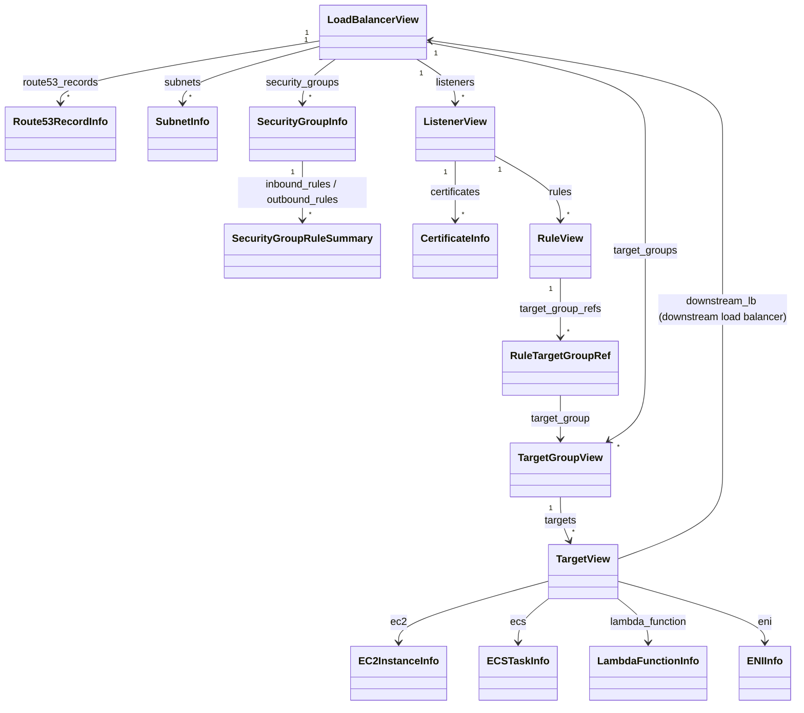
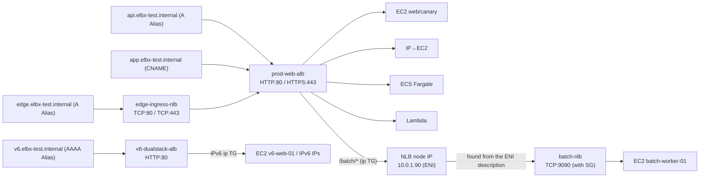

<div align="center">

# elbx

**A read-only CLI and Python library that shows an AWS ALB / NLB in one command, down to what each target actually is (EC2, ECS, Lambda, ...)**

[](https://github.com/gyuro-dev/elbx/actions/workflows/ci.yml)
[](https://github.com/gyuro-dev/elbx/blob/main/LICENSE)


[](#-built-with-ai)

English | [日本語](https://github.com/gyuro-dev/elbx/blob/main/README.ja.md)

[Features](#-features) ・ [Quick start](#-quick-start) ・ [Usage](#-usage) ・ [Reference](#-reference)

</div>

---

**elbx** shows an AWS load balancer (ALB / NLB) in one command.
It fetches the listeners, rules, target groups and targets together, works out what each target actually is (an EC2 instance, an ECS task, a Lambda function or another load balancer), and shows it all as one tree.

```text
$ elbx tree prod-web-alb
[APPLICATION] prod-web-alb (internet-facing, active)
│  api.elbx-test.internal, app.elbx-test.internal
├── HTTP:80
│   ├── [10] Path /health-http
│   │   └── prod-web-tg [2/2 healthy]
│   │       ├── ● web-prod-01
│   │       └── ● web-prod-02
│   └── [default]
│       └── Redirect (HTTP_301) -> HTTPS://#{host}:443/#{path}
└── HTTPS:443  cert=*.elbx-test.internal
    ├── [10] Host api.elbx-test.internal AND Path /v1/*
    │   ├── prod-web-tg (weight=90) [2/2 healthy]
    │   │   ├── ● web-prod-01
    │   │   └── ● web-prod-02
    │   └── prod-canary-tg (weight=10) [1/1 healthy]
    │       └── ● canary-prod-01
    ├── [20] Header(X-Env) ip-direct AND Method GET, POST AND Query mode=fast AND SourceIP 203.0.113.0/24
    │   └── prod-ip-tg [1/1 healthy]
    │       └── ● web-prod-01 (ip)
    ├── [25] Path /ecs/*
    │   └── prod-ecs-tg [1/1 healthy]
    │       └── ● ECS prod-ecs-cluster/api-fargate-svc
    ├── [28] Path /auth/*
    │   └── prod-lambda-tg [0/1 healthy, 1 unavailable]
    │       └── ○ Lambda prod-auth-fn (unavailable)
    ├── [29] Path /batch/*
    │   └── alb-to-nlb-tg [1/1 healthy]
    │       └── ● NLB batch-nlb (10.0.1.90)
    │           └── TCP:9090
    │               └── [default]
    │                   └── batch-nlb-tg [1/1 healthy]
    │                       └── ● batch-worker-01
    ├── [30] Path /legacy/*
    │   └── Redirect (HTTP_301) -> HTTPS://new.elbx-test.internal:443/modern
    ├── [40] Path /maintenance
    │   └── FixedResponse (503, text/plain)
    └── [default]
        └── prod-web-tg [2/2 healthy]
            ├── ● web-prod-01
            └── ● web-prod-02
```

It also tells you which rule a request matches and where it ends up, from the configuration alone (no request is sent).

```text
$ elbx route https://api.elbx-test.internal/v1/users
GET https://api.elbx-test.internal/v1/users

Entry: [APPLICATION] prod-web-alb (Listener HTTPS:443)
  ✓ Rule [priority:10] IF Host in [api.elbx-test.internal] AND Path in [/v1/*]
      Host 'api.elbx-test.internal' matches [api.elbx-test.internal]
      Path '/v1/users' matches [/v1/*]
  => Forward -> prod-web-tg (weight=90), prod-canary-tg (weight=10)
     TG: prod-web-tg (weight=90) [2/2 healthy]
       - [● healthy] web-prod-01 (i-eebe194c6ae2318e8) port=8080
       - [● healthy] web-prod-02 (i-40bd93b155cd6d603) port=8080
     TG: prod-canary-tg (weight=10) [1/1 healthy]
       - [● healthy] canary-prod-01 (i-35d44a0bce1ae290a) port=8080
```

- 🔒 **Read-only**: elbx calls only read APIs and never changes anything in your AWS account
- 📦 **boto3 is the only dependency**: the trees, the tables and the CLI are built on the Python standard library alone

> The example outputs come from the test setup of this repository (`tests/data/infra.yaml`).

## ✨ Features

| | Feature | Command |
| :-: | :--- | :--- |
| 🌳 | Load balancer → listeners → rules → target groups → targets in **one tree**. A short relationship map by default; `--full` adds Route 53, security groups, subnets, certificates, attributes and the details of every target | `elbx tree` |
| 🔎 | **Finds out what each target is**: EC2 / ECS (Fargate, bridge) / Lambda / IP targets (ENI) / downstream load balancers (NLB → ALB, ALB → NLB). Works with IPv4, dual-stack and IPv6-only setups | `elbx tree` / `targets` |
| 🧭 | Evaluates **which rule a request matches and where it ends up**, explaining why each condition did or did not match (and following chained load balancers) | `elbx route` |
| 🚨 | Lists **only the targets that need attention** across all load balancers, with the reason and the health check settings | `elbx targets --unhealthy` |
| 🔁 | Reverse lookup: given an EC2 Name or IP, an ECS service, a Lambda function or a load balancer name, finds **which load balancers and target groups it is registered with** | `elbx find` |
| 🐍 | Everything the CLI shows is also available from Python as **typed objects** | `ELBClient` |

## 🚀 Quick start

```bash
uv tool install git+https://github.com/gyuro-dev/elbx.git    # or: pipx install git+https://github.com/gyuro-dev/elbx.git
```

To use it from Python, add it to your project: `uv add git+https://github.com/gyuro-dev/elbx.git` or `pip install git+https://github.com/gyuro-dev/elbx.git`.

```bash
elbx ls                                              # list the load balancers
elbx tree my-alb                                     # one load balancer as a tree
elbx route https://api.example.org/v1/users          # where does this request go?
elbx targets --unhealthy                             # only the targets that need attention
elbx find web-01                                     # which load balancer is this EC2 behind?
```

elbx uses the same AWS credentials as the AWS CLI (environment variables, `~/.aws/config`, SSO, ...). Use `--profile` / `--region` to pick the profile and the region.

Output is in English or Japanese; by default it follows your OS language (see [Language](#language)).

> [!TIP]
> No AWS account? You can try the output against a local mock of AWS ([moto](https://github.com/getmoto/moto)): `uv run python playground.py` (see "For developers" in the [Reference](#-reference))

## 📖 Usage

> Long outputs are collapsed; click ▶ to expand them.

### `elbx tree` — see a whole load balancer as a tree

Shows load balancer → listeners → rules → target groups (with weights) → targets as one tree.
By default it draws a **relationship map**: one short line each for the rule conditions, the health count of each target group and the target names. Within each target group, the targets that are not healthy come first: `unhealthy` in red, `draining` and `initial` in yellow, so the ones with a problem are easy to spot.
With `--full`, it also shows the Route 53 records, the security group rules, subnets, certificates, the attributes of the load balancer and the target groups, and the details of every target (IP, AZ, instance type, ...).

```bash
elbx tree prod-web-alb                         # relationship map of one load balancer
elbx tree                                      # every load balancer
elbx tree -s prod                              # load balancers with prod in the name
elbx tree prod-web-alb --full                  # everything: attributes, SGs, subnets, target details
elbx tree prod-web-alb --full --no-network --no-dns   # everything but SGs, subnets and Route 53 (faster)
elbx tree prod-web-alb --json > alb.json       # everything as JSON
```

<details>
<summary>Example: <code>elbx tree prod-web-alb</code> (during an incident: the targets that are not healthy come first)</summary>

```text
[APPLICATION] prod-web-alb (internet-facing, active)
│  api.elbx-test.internal, app.elbx-test.internal
├── HTTP:80
│   ├── [10] Path /health-http
│   │   └── prod-web-tg [1/2 healthy, 1 unhealthy]
│   │       ├── ✖ web-prod-02 (unhealthy)
│   │       └── ● web-prod-01
│   └── [default]
│       └── Redirect (HTTP_301) -> HTTPS://#{host}:443/#{path}
└── HTTPS:443  cert=*.elbx-test.internal
    ├── [10] Host api.elbx-test.internal AND Path /v1/*
    │   ├── prod-web-tg (weight=90) [1/2 healthy, 1 unhealthy]
    │   │   ├── ✖ web-prod-02 (unhealthy)
    │   │   └── ● web-prod-01
    │   └── prod-canary-tg (weight=10) [0/1 healthy, 1 draining]
    │       └── ◐ canary-prod-01 (draining)
    ├── [20] Header(X-Env) ip-direct AND Method GET, POST AND Query mode=fast AND SourceIP 203.0.113.0/24
    │   └── prod-ip-tg [1/1 healthy]
    │       └── ● web-prod-01 (ip)
    ├── [25] Path /ecs/*
    │   └── prod-ecs-tg [1/1 healthy]
    │       └── ● ECS prod-ecs-cluster/api-fargate-svc
    ├── [28] Path /auth/*
    │   └── prod-lambda-tg [0/1 healthy, 1 initial]
    │       └── ◐ Lambda prod-auth-fn (initial)
    ├── [29] Path /batch/*
    │   └── alb-to-nlb-tg [1/1 healthy]
    │       └── ● NLB batch-nlb (10.0.1.90)
    │           └── TCP:9090
    │               └── [default]
    │                   └── batch-nlb-tg [1/1 healthy]
    │                       └── ● batch-worker-01
    ├── [30] Path /legacy/*
    │   └── Redirect (HTTP_301) -> HTTPS://new.elbx-test.internal:443/modern
    ├── [40] Path /maintenance
    │   └── FixedResponse (503, text/plain)
    └── [default]
        └── prod-web-tg [1/2 healthy, 1 unhealthy]
            ├── ✖ web-prod-02 (unhealthy)
            └── ● web-prod-01
```

</details>

<details>
<summary>Example: <code>elbx tree prod-web-alb --full</code> (partly omitted)</summary>

```text
[APPLICATION] prod-web-alb (internet-facing, state=active, vpc=vpc-e9cb8defe2411ab19)
│  DNS: prod-web-alb-1.ap-northeast-1.elb.amazonaws.com
│  Route53: api.elbx-test.internal (A Alias, zone=elbx-test.internal [Private]), app.elbx-test.internal (CNAME, zone=elbx-test.internal [Private])
│  Attributes: cross_zone=off, deletion_protection=off
├── Network & Security
│   ├── Subnets (2 AZs)
│   │   ├── ap-northeast-1a: subnet-9f75c2c3f85f6074d (public-subnet-1a) [10.0.1.0/24, 2001:db8:1:1::/64]
│   │   └── ap-northeast-1c: subnet-98d07c497a9e06c85 (public-subnet-1c) [10.0.2.0/24, 2001:db8:1:2::/64]
│   └── Security Groups (1)
│       └── sg-d820c3c652b9103b9 (prod-alb-sg)
│           ├── in  allow TCP:443 from 10.0.0.0/16 # HTTPS from VPC
│           ├── in  allow ALL:ALL from 10.0.0.0/16 # All VPC internal
│           └── out allow ALL:ALL to 0.0.0.0/0
└── Listeners (2)
    ├── Listener HTTP:80
    │   └── Rule [default] IF DEFAULT (every request no other rule matched)
    │       └── Redirect (HTTP_301) -> HTTPS://#{host}:443/#{path}
    └── Listener HTTPS:443 [SSLPolicy: ELBSecurityPolicy-TLS13-1-2-2021-06]
        ├── ACM Cert: *.elbx-test.internal (4c046ae0-ef28-4bf3-bab6-6ec32d540239, status=PENDING_VALIDATION, expires=2027-10-17)
        ├── Rule [priority:10] IF Host in [api.elbx-test.internal] AND Path in [/v1/*]
        │   ├── TG: prod-web-tg (weight=90) (HTTP:8080, type=instance, HC=HTTP:traffic-port/healthz) [2/2 healthy]
        │   │   ├── attrs: dereg_delay=300s
        │   │   ├── [● healthy] web-prod-01 [id=i-88c6e44c0bb0ea3e6, port=8080, ip=10.0.1.11, az=ap-northeast-1a, type=t3.medium, ec2=running]
        │   │   │   └── net: subnet=public-subnet-1a (subnet-9f75c2c3f85f6074d, 10.0.1.0/24, 2001:db8:1:1::/64) | sg=prod-alb-sg (sg-d820c3c652b9103b9)
        │   │   └── [● healthy] web-prod-02 [id=i-f75dd6e70a2a90cf1, port=8080, ip=10.0.2.12, az=ap-northeast-1c, type=t3.medium, ec2=running]
        │   └── TG: prod-canary-tg (weight=10) (HTTP:8080, type=instance, HC=HTTP:traffic-port/healthz) [1/1 healthy]
        │       └── [● healthy] canary-prod-01 [id=i-f35eac4266f7e9663, port=8080, ip=10.0.1.21, az=ap-northeast-1a, type=t3.small, ec2=running]
        ├── Rule [priority:25] IF Path in [/ecs/*]
        │   └── TG: prod-ecs-tg (HTTP:9000, type=ip, HC=HTTP:traffic-port/ecs-health) [1/1 healthy]
        │       └── [● healthy] [ECS:FARGATE] prod-ecs-cluster/api-fargate-svc [port=9000, ip=10.0.1.60, container=api-container, def=api-fargate-task:1, az=ap-northeast-1a]
        ├── Rule [priority:28] IF Path in [/auth/*]
        │   └── TG: prod-lambda-tg (type=lambda) [0/1 healthy, 1 unavailable]
        │       └── [○ unavailable] [Lambda] prod-auth-fn [runtime=python3.12, handler=index.handler, state=Active] (Target.HealthCheckDisabled: Health checks are not enabled for this target)
        ├── Rule [priority:29] IF Path in [/batch/*]
        │   └── TG: alb-to-nlb-tg (HTTP:9090, type=ip, HC=HTTP:traffic-port/) [1/1 healthy]
        │       └── [● healthy] [IP->NLB] batch-nlb [port=9090, ip=10.0.1.90, az=ap-northeast-1a, eni=eni-09d063400d2fadc20, scheme=internal, ...]
        │           └── Listeners (1)
        │               └── Listener TCP:9090
        │                   └── Rule [default] IF DEFAULT (every request no other rule matched)
        │                       └── TG: batch-nlb-tg (TCP:9090, type=instance, HC=TCP:traffic-port) [1/1 healthy]
        │                           └── [● healthy] batch-worker-01 [id=i-9bf2f3b2796585bf5, port=9090, ip=10.0.1.71, az=ap-northeast-1a, ...]
        ├── Rule [priority:40] IF Path in [/maintenance]
        │   └── FixedResponse (503, text/plain)
        └── ...
```

</details>

| Argument / option | Default | Description |
| :--- | :--- | :--- |
| `NAME_OR_ARN` | every load balancer | The name or ARN of the load balancer. Cannot be combined with `--search`. A load balancer that does not exist is an error (exit code `1`). |
| `-s`, `--search WORD` | none | Only the load balancers whose name or DNS name contains `WORD` (case-insensitive). Cannot be combined with `NAME_OR_ARN`. When nothing matches, it prints "No load balancers found." and exits with `0`. |
| `-f`, `--full` | relationship map | Everything: the type and zone of the Route 53 records, the attributes of the load balancer and the target groups, subnets and security group rules, certificate expiry, and the ID, IP, AZ, instance type, subnet and security groups of every target. The default relationship map shows only the listeners, the rules (priority and conditions), the target groups (health count) and the target names, and skips subnets and security groups, so it is faster. |
| `--max-targets N` | `10` | How many targets the relationship map names in each target group. The rest collapse into one `… N more (healthy)` line; targets that are not healthy are always named. `0` names them all. Ignored with `--full`. |
| `--no-network` | fetched | With `--full`, skip the subnets and security groups of the load balancers and the targets. The "Network & Security" section and the `net:` lines under the targets go away, and fewer API calls make the run faster. |
| `--no-dns` | fetched | Skip the Route 53 hosted zones and the `Route53:` line. For accounts where many zones or records make the scan slow. |
| `--json` | text | Output the same content as JSON (an array of load balancers), plus what the tree does not show, such as every attribute and the rule conditions (`condition_specs`). |

---

### `elbx route` — check where a request goes

Works out, from the configuration alone, which listener rule a request matches and which target groups and targets it reaches. No request is actually sent.
Rules are evaluated in priority order, and every rule that does not match shows why. Chains such as NLB → ALB are followed into the downstream load balancer.

```bash
elbx route https://api.elbx-test.internal/v1/users
elbx route https://edge.elbx-test.internal/auth/login                 # enter at the NLB and follow it into the ALB
elbx route "https://api.elbx-test.internal/x?mode=fast" -X POST -H "X-Env: ip-direct" --source-ip 203.0.113.10
elbx route https://new-host.example.org/ --lb prod-web-alb            # try a host name not in DNS yet
```

<details>
<summary>Example: <code>elbx route https://edge.elbx-test.internal/auth/login</code></summary>

```text
GET https://edge.elbx-test.internal/auth/login

Entry: [NETWORK] edge-ingress-nlb (Listener TCP:443)
  ✓ Rule [default] IF DEFAULT (every request no other rule matched)
      no rule matched, so the default rule applies
  => Forward -> nlb-to-alb-tg
     TG: nlb-to-alb-tg [1/1 healthy]
    ↓ Forwarded to: [APPLICATION] prod-web-alb (Listener HTTPS:443)
      ✗ Rule [priority:10] IF Host in [api.elbx-test.internal] AND Path in [/v1/*]
          Host 'edge.elbx-test.internal' matches none of [api.elbx-test.internal]
          Path '/auth/login' matches none of [/v1/*]
      ✗ Rule [priority:20] IF Header(X-Env) in [ip-direct] AND Method in [GET, POST] AND Query in [mode=fast] AND SourceIP in [203.0.113.0/24]
          Header(X-Env) is not in the request (give it with -H)
          Query '(none)' matches none of [mode=fast]
          no source IP given, so taken as not matching (give it with --source-ip)
      ✗ Rule [priority:25] IF Path in [/ecs/*]
          Path '/auth/login' matches none of [/ecs/*]
      ✓ Rule [priority:28] IF Path in [/auth/*]
          Path '/auth/login' matches [/auth/*]
      => Forward -> prod-lambda-tg
         TG: prod-lambda-tg [0/1 healthy, 1 unavailable]
           - [○ unavailable] Lambda:prod-auth-fn port=- (Target.HealthCheckDisabled)
```

</details>

<details>
<summary>Example: <code>elbx route "https://api.elbx-test.internal/x?mode=fast" -X POST -H "X-Env: ip-direct" --source-ip 203.0.113.10</code></summary>

```text
POST https://api.elbx-test.internal/x?mode=fast

Entry: [APPLICATION] prod-web-alb (Listener HTTPS:443)
  ✗ Rule [priority:10] IF Host in [api.elbx-test.internal] AND Path in [/v1/*]
      Path '/x' matches none of [/v1/*]
  ✓ Rule [priority:20] IF Header(X-Env) in [ip-direct] AND Method in [GET, POST] AND Query in [mode=fast] AND SourceIP in [203.0.113.0/24]
      Header(X-Env) 'ip-direct' matches [ip-direct]
      Method 'POST' matches [GET, POST]
      Query 'mode=fast' matches [mode=fast]
      SourceIP '203.0.113.10' matches [203.0.113.0/24]
  => Forward -> prod-ip-tg
     TG: prod-ip-tg [1/1 healthy]
       - [● healthy] web-prod-01 (10.0.1.11) port=9000
```

</details>

| Argument / option | Default | Description |
| :--- | :--- | :--- |
| `URL` | (required) | The URL of the request (`https://host[:port]/path?query`). Without a scheme, `http` is assumed. Without a port, the listener on port 80 (`http`) or 443 (`https`) is evaluated. The host is lower-cased before matching; the path and the query are matched against the path and query string conditions. |
| `--lb NAME_OR_ARN` | found from the host name | The name or ARN of the entry load balancer. When omitted, elbx looks for a load balancer whose DNS name is the host name, then for Route 53 records (exact, then wildcard; a wildcard record is not used when the same zone has a record with the host name itself; only the hosted zones named after the host name or a parent domain of it are read), and fails if nothing is found. Use it for a host name that is not in DNS yet, or to pin the entry point. |
| `-X`, `--method METHOD` | `GET` | The HTTP method, matched against `http-request-method` conditions. As on the ALB, it is case-sensitive (`post` does not match `POST`), so write it in upper case. |
| `-H`, `--header 'NAME: VALUE'` | none | A request header (repeatable). Matched against `http-header` conditions, with the name and the value case-insensitive. A rule with a condition on a header you did not give does not match, and its reason says so. If you give `Host`, `host-header` conditions use its value (without the port) instead of the host name of the URL. |
| `--source-ip IP` | none | The client IP address (IPv4 / IPv6), matched against `source-ip` conditions. When omitted, rules with a `source-ip` condition do not match. A value that is not an IP address is an error. |
| `--json` | text | The result as JSON: the evaluated rules and their reasons (`evaluations`), the matched rule (`matched_rule_priority`), the action, the target groups (weight, health, targets), the downstream load balancers (`downstream`) and, when the evaluation stopped, why (`note`, and `note_code` for programs: `no_listener` / `no_matching_rule` / `too_many_hops`). |

<details>
<summary>How the rules are evaluated (the same as the ALB)</summary>

- Rules are evaluated from the lowest priority number up, and evaluation stops at the first match. If none matches, the default rule applies
- The conditions of a rule are AND-ed, the values of a condition are OR-ed. The wildcards `*` (any characters, including none) and `?` (one character) are supported (in a `query-string` condition, `\*` and `\?` stand for the characters themselves)
- Hosts, HTTP headers and query strings are case-insensitive; paths and HTTP methods are case-sensitive
- The query string is percent-decoded as a whole and then split at `&` and `=` (`+` stays `+`, it is not a space). A `query-string` condition without a key is matched against the whole query string as written, before decoding
- The path is percent-decoded (`%2F` becomes `/` too) and its `.` and `..` segments are removed before it is matched
- When another load balancer is registered in a target group of the matched rule, evaluation continues on that load balancer's listener for the target's port. This covers an ALB registered in an `alb` target group of an NLB, and the node IPs of a load balancer registered in an `ip` target group
- A target group of weight 0 receives no requests, so its line says `(receives no requests)` and its targets and downstream load balancers are not followed
- Only listener rules are evaluated; whether security groups, network ACLs and route tables let the traffic through is not checked

</details>

---

### `elbx targets` — list targets and check them during an incident

Lists the targets of each target group, one line each, with the kind, what the target is, IP, AZ, subnet, security groups and health.
With `--unhealthy`, it lists only the targets that need attention, across every load balancer, with the reason and the health check settings. During an incident, this is the first command to run.

```bash
elbx targets --unhealthy            # only the targets that need attention (every load balancer)
elbx targets prod-web-alb           # the target groups of one load balancer
elbx targets --tg prod-web-tg       # one target group
elbx targets -s api --unhealthy     # target groups with api in the name
elbx targets                        # every target group (including those not attached to a load balancer)
```

<details>
<summary>Example: <code>elbx targets --unhealthy</code> (during an incident)</summary>

```text
TARGET GROUP    KIND    TARGET ID            RESOURCE / NAME                    ...  ELB HEALTH  STATE    REASON                           DETAIL                                        HEALTH CHECK
--------------  ------  -------------------  ---------------------------------  ...  ----------  -------  -------------------------------  --------------------------------------------  ------------------------------------------------------------------------------
prod-canary-tg  ec2     i-f35eac4266f7e9663  canary-prod-01                     ...  draining    running  Target.DeregistrationInProgress  Target deregistration is in progress          HTTP:traffic-port/healthz 200 every 30s (timeout 5s, unhealthy x2, healthy x5)
prod-lambda-tg  lambda  arn:aws:lambda:...   Lambda: prod-auth-fn (python3.12)  ...  initial     Active   Elb.RegistrationInProgress       Target registration is in progress            -
prod-web-tg     ec2     i-f75dd6e70a2a90cf1  web-prod-02                        ...  unhealthy   running  Target.FailedHealthChecks        Health checks failed with these codes: [502]  HTTP:traffic-port/healthz 200 every 30s (timeout 5s, unhealthy x2, healthy x5)
```

(`...` stands for the private IP, port, AZ, subnet and security group columns)

</details>

<details>
<summary>Example: <code>elbx targets prod-web-alb</code></summary>

```text
TARGET GROUP    KIND    TARGET ID            RESOURCE / NAME                        PRIVATE IP  PORT  AZ               SUBNET                                       SECURITY GROUPS                      ELB HEALTH  STATE    REASON
--------------  ------  -------------------  -------------------------------------  ----------  ----  ---------------  -------------------------------------------  -----------------------------------  ----------  -------  ------
alb-to-nlb-tg   nlb     10.0.1.90            NLB: batch-nlb                         10.0.1.90   9090  ap-northeast-1a  public-subnet-1a (subnet-9f75c2c3f85f6074d)  batch-nlb-sg (sg-fd0e3a203cd6895b8)  healthy     active   -
prod-ecs-tg     ecs     10.0.1.60            ECS: prod-ecs-cluster/api-fargate-svc  10.0.1.60   9000  ap-northeast-1a  public-subnet-1a (subnet-9f75c2c3f85f6074d)  prod-alb-sg (sg-d820c3c652b9103b9)   healthy     ACTIVE   -
prod-ip-tg      ec2     10.0.1.11            web-prod-01                            10.0.1.11   9000  ap-northeast-1a  public-subnet-1a (subnet-9f75c2c3f85f6074d)  prod-alb-sg (sg-d820c3c652b9103b9)   healthy     running  -
prod-web-tg     ec2     i-88c6e44c0bb0ea3e6  web-prod-01                            10.0.1.11   8080  ap-northeast-1a  public-subnet-1a (subnet-9f75c2c3f85f6074d)  prod-alb-sg (sg-d820c3c652b9103b9)   healthy     running  -
```

</details>

| Argument / option | Default | Description |
| :--- | :--- | :--- |
| `LB` | every target group | The name or ARN of a load balancer; only its target groups are shown. When omitted (and without `--tg`), every target group is shown, including those not attached to a load balancer. |
| `--tg TG` | - | Only this target group (name or ARN). Give either `LB` or `--tg`, not both. |
| `-s`, `--search TEXT` | - | Only the target groups whose name contains this text (case-insensitive). Can be combined with `LB` (but not with `--tg`). |
| `--unhealthy` | everything | Only the targets that need attention: those that are not healthy (`unhealthy` / `draining` / `initial` / `unused` / `unavailable`), minus the states the configuration itself causes. Those are `unavailable` with `Target.HealthCheckDisabled` (health checks turned off, the default for a Lambda target group) and `unused` in a target group that no load balancer uses. A stopped instance (`unused`) in a target group that is in use is still shown. Adds two columns: `DETAIL` (a description of the state) and `HEALTH CHECK` (protocol, port, path, success codes, interval, timeout, thresholds). When nothing matches, it prints "No targets need attention.". With `--json`, the JSON is filtered the same way. |
| `--json` | text | An array of target groups as JSON, with the health check settings, the attributes, the counts (`summary`: `by_state` per state and `attention`) and the details of every target (EC2 / ECS / Lambda / ENI / downstream load balancer). |

The `KIND` column is what the target is (`ec2` / `ecs` / `lambda` / `alb` / `nlb` / `eni` / `ip`). The `STATE` column is the state of the resource itself (`running` for EC2, `RUNNING` for ECS, `active` for a load balancer, ...).

---

### `elbx find` — find which load balancer something is behind

Given the name, ID or IP of an EC2 instance, a container, a Lambda function or a load balancer, finds the load balancers and target groups it is registered with.

```bash
elbx find web-prod-01        # EC2 Name tag
elbx find 10.0.1.11          # private IP
elbx find api-fargate-svc    # ECS service name (a cluster name or task ID works too)
elbx find prod-auth-fn       # Lambda function name
elbx find batch-nlb          # NLB name -> the ALB and target group that register the NLB's node IPs
```

<details>
<summary>Example: <code>elbx find web-prod-01</code></summary>

```text
LOAD BALANCER  TARGET GROUP  KIND  TARGET ID            RESOURCE / NAME  PRIVATE IP  PORT  ELB HEALTH  STATE
-------------  ------------  ----  -------------------  ---------------  ----------  ----  ----------  -------
prod-web-alb   prod-ip-tg    ec2   10.0.1.11            web-prod-01      10.0.1.11   9000  healthy     running
prod-web-alb   prod-web-tg   ec2   i-88c6e44c0bb0ea3e6  web-prod-01      10.0.1.11   8080  healthy     running
```

</details>

| Argument / option | Default | Description |
| :--- | :--- | :--- |
| `QUERY` | (required) | The text to look for: a case-insensitive **substring** match (IP addresses must match as a whole). Matched against: EC2 Name / instance ID / private IP / public IP, ECS cluster / service / task ID / task definition / container name, Lambda function name / ARN, downstream load balancer name / ARN / DNS name, ENI ID / description (the ENI of a load balancer node also matches the load balancer name), and the target ID. An ARN is matched by its name part only (the function name, the load balancer name and ID), so a region name or an account ID does not match; to search by a whole ARN, start the text with `arn:`. An empty string is an error. |
| `--json` | text | An array of results as JSON (with the details of the load balancer, the target group and the target). |

- A target registered with several load balancers or target groups gets one line for each (`web-prod-01` is registered both by instance ID and by IP, so it gets two lines)
- It is a substring match, so `web-prod` finds both `web-prod-01` and `web-prod-02`. To pin down a single instance, search by instance ID or IP
- An IP address is matched as a whole, so `elbx find 10.0.1` finds nothing; when the text looks like part of an IP address, a hint says so
- For a target in a target group that is not attached to a load balancer, the `LOAD BALANCER` column is `(not attached to a load balancer)`

---

### `elbx ls` — list the load balancers

One line per load balancer with its type, scheme, state, listeners, health count and Route 53 record names.\
When targets need attention, the `TARGETS` column adds how many, in red (`4/7 (6 TGs, attention: 3)`). States that the configuration itself causes, such as a Lambda with health checks disabled, are not counted.\
What the table does not show (what the targets are, certificates, attributes, subnets, security groups) is not fetched, so it is faster than `--json`.

```bash
elbx ls
elbx ls -s batch
```

<details>
<summary>Example: <code>elbx ls</code></summary>

```text
NAME              TYPE         SCHEME                STATE   VPC                    LISTENERS           TARGETS (HEALTHY/TOTAL)  ROUTE53 / DNS NAME
----------------  -----------  --------------------  ------  ---------------------  ------------------  -----------------------  -------------------------------------------------------------------------------------------------
prod-web-alb      application  internet-facing       active  vpc-c05aed80b218ef684  HTTP:80, HTTPS:443  6/7 (6 TGs)              api.elbx-test.internal, app.elbx-test.internal -> prod-web-alb-1.ap-northeast-1.elb.amazonaws.com
edge-ingress-nlb  network      internal              active  vpc-c05aed80b218ef684  TCP:80, TCP:443     1/1 (1 TGs)              edge.elbx-test.internal -> edge-ingress-nlb-1.ap-northeast-1.elb.amazonaws.com
batch-nlb         network      internal              active  vpc-c05aed80b218ef684  TCP:9090            1/1 (1 TGs)              batch-nlb-1.ap-northeast-1.elb.amazonaws.com
v6-dualstack-alb  application  internal (dualstack)  active  vpc-c05aed80b218ef684  HTTP:80             3/3 (1 TGs)              v6.elbx-test.internal -> v6-dualstack-alb-1.ap-northeast-1.elb.amazonaws.com
```

</details>

| Option | Default | Description |
| :--- | :--- | :--- |
| `-s`, `--search WORD` | none | Show only the load balancers whose name or DNS name contains `WORD` (case-insensitive). |
| `--no-dns` | fetched | Skip the Route 53 hosted zones; the `ROUTE53 / DNS NAME` column shows only the DNS name. |
| `--json` | text | An array of load balancers as JSON. The table skips subnets and security groups for speed; `--json` fetches and includes them. |

---

### Pipe the JSON into other tools

Every command has `--json`.

```bash
# only the names and reasons of the targets that are not healthy
elbx targets --unhealthy --json | jq -r '.[].targets[] | "\(.display_name)\t\(.health_reason)"'

# which target groups does this path go to, with what weights?
elbx route https://api.elbx-test.internal/v1/users --json | jq '.entries[0].target_groups[] | {name, weight}'
```

### Use it from Python

Everything the CLI shows is available as dataclasses; there is no need to parse the text.

```python
from elbx import ELBClient, print_lb_tree

client = ELBClient(profile_name="my-profile", region_name="ap-northeast-1")

lb = client.get_load_balancer("prod-web-alb")
print_lb_tree(lb)  # the same as tree --full on the CLI (the relationship map is format_lb_map(lb))

for t in lb.all_targets:  # the same code for every kind of target
    print(t.target_kind, t.display_name, t.ip_address, t.availability_zone, t.health_state)

result = client.simulate_request("https://api.elbx-test.internal/v1/users")
hop = result.entries[0]
if hop.matched_rule:  # None when nothing was evaluated (hop.note_code says why: "no_listener", ...)
    print(hop.matched_rule.actions_summary)
# ['Forward -> prod-web-tg (weight=90), prod-canary-tg (weight=10)']
```

The package ships type hints (`py.typed`), so the examples in this README pass `mypy --strict` as they are.

For more, see "Python API reference" and "Recipes" in the [Reference](#-reference).

---

### Global options

| Option | Default | Description |
| :--- | :--- | :--- |
| `-p`, `--profile NAME` | as the AWS CLI (`AWS_PROFILE` → `default`) | The AWS profile. SSO profiles work too (log in first with `aws sso login --profile NAME`). |
| `-r`, `--region REGION` | the profile's region (or `AWS_REGION`) | The region to inspect. Each run covers a single region. |
| `-j`, `--workers N` | `10` | AWS API calls run in parallel (the limit for the whole command). Higher is faster but more likely to hit the rate limit (`Rate exceeded`; a throttled call is retried up to 10 times, or as the `AWS_RETRY_MODE` / `AWS_MAX_ATTEMPTS` environment variables say when set). `1` makes the calls one at a time. With a region name botocore does not know (a typo, usually) a call is tried only twice, so the error comes at once. |
| `--color` / `--no-color` | colored on a terminal | `--color` colors the output even when it is not a terminal (a pipe to `less -R`, a CI log); `--no-color` turns colors off. Without either, output to a file or a pipe is not colored. The `FORCE_COLOR` and `NO_COLOR` environment variables have the same effects (`FORCE_COLOR` wins when both are set). |
| `-v`, `--verbose` | off | Shows details on stderr: `-v` what could not be fetched and why, `-vv` also every AWS API call and how long it took (see [Logs](#logs)). |
| `--lang en\|ja` | `ELBX_LANG`, then the OS language | The language of the help, the messages and the labels in the output (see [Language](#language)). |

- Global options can go before the subcommand (`elbx --profile prod tree`) or after it (`elbx tree --profile prod`)
- Without a subcommand, elbx runs `tree`: `elbx` alone shows every load balancer, and the options of `tree` work as they are (`elbx --full`, `elbx --search prod`)
- To show a single load balancer, spell out `tree`: `elbx tree my-alb`. `elbx my-alb` is an error, and the message shows the correct form
- `elbx --version` shows the version
- Exit codes: `0` = success (including "nothing found"), `1` = error (load balancer not found, access denied, bad URL, ...), `2` = bad arguments, `130` = interrupted with Ctrl-C
- When a name is not found, elbx checks whether it was given in the wrong place and says so on a `Hint:` line: a target group name given as a load balancer (`elbx targets my-tg`) points to `elbx targets --tg my-tg`, the reverse points to `elbx targets my-alb`, and a name given to `elbx route` instead of a URL shows how to write the URL

### Language

Help, messages and output labels (such as `Entry:` and the reasons shown by `elbx route`) are in English or Japanese. elbx picks the language in this order:

1. `--lang en` / `--lang ja`
2. the `ELBX_LANG` environment variable (`en` or `ja`; any other value is an error)
3. the locale environment variables `LC_ALL`, `LC_MESSAGES`, `LANG` (a value starting with `ja`, such as `ja_JP.UTF-8`, gives Japanese)
4. on Windows, the display language

If none of these applies, the language is English. AWS resource names, IDs and keys, and the `--json` keys, are the same in both languages.

### Logs

When elbx cannot fetch a detail, such as security groups it has no permission to read, it leaves that detail empty, keeps going and prints one note on stderr. The exit code stays `0` (when the command fails for another reason, the same note follows the error).

```text
Note: 2 request(s) for details failed, so some information may be missing (-v shows which).
```

`-v` shows what could not be fetched and why, and `-vv` also shows every AWS API call. Logs go to stderr, so `--json` can still be piped.

```text
$ elbx tree prod-web-alb --full -vv
DEBUG: elbv2.DescribeLoadBalancers: HTTP 200, 41 ms
WARNING: could not fetch security groups, continuing without it: An error occurred (UnauthorizedOperation) when calling ...
```

The logs have no request parameters or headers, and elbx does not turn on the debug log of botocore, which contains request signatures.

In Python, use the `elbx` logger of the standard `logging` module. By default, it shows nothing.

```python
import logging

logging.basicConfig()
logging.getLogger("elbx").setLevel(logging.WARNING)  # or logging.DEBUG for every API call
```

## 🤖 Built with AI

The code, tests and documentation of this repository were written with Anthropic's **Claude** (Claude Code).
The author (gyuro, [@gyuro-dev](https://github.com/gyuro-dev)) decides what to build and what not to, sets the specification and reviews the work.

- The tests run on moto (mock AWS) and compare the entire output against the expected output
- The same tests have also been run on a real AWS account (a test setup with three load balancers). **elbx has not been checked on a large account with many load balancers and target groups yet**. If you run into a problem, please open an issue

## 📚 Reference

<details>
<summary><b>Python API reference</b></summary>

#### `ELBClient`

| Method | Returns | Description |
| :--- | :--- | :--- |
| `ELBClient(profile_name=None, region_name=None, session=None, max_workers=10)` | – | An existing `boto3.Session` can be given as `session`; `region_name` still applies to the clients made from it, and `profile_name` together with `session` is a `ValueError`. No region at all (also an empty `AWS_REGION`) is an `AWSAPIError` |
| `list_load_balancers(names=None, search=None, include_relations=True, include_network=True, include_dns=True, include_certificates=True, include_attributes=True, resolve_targets=True)` | `list[LoadBalancerView]` | The load balancers with everything behind them |
| `get_load_balancer(name_or_arn, include_network=True, include_dns=True, include_certificates=True, include_attributes=True, resolve_targets=True)` | `LoadBalancerView` | One load balancer with everything behind it |
| `list_target_groups(lb_name_or_arn=None, names=None, search=None, include_attributes=True, expand_downstream=True)` | `list[TargetGroupView]` | The target groups and what their targets are |
| `get_target_group(name_or_arn, include_attributes=True, expand_downstream=True)` | `TargetGroupView` | One target group |
| `find_target(query, include_network=True, expand_downstream=True)` | `list[TargetLookupResult]` | Reverse lookup across the account (the same as `elbx find`) |
| `simulate_request(url, method="GET", headers=None, source_ip=None, lb_name_or_arn=None)` | `RouteSimulationResult` | Route evaluation (the same as `elbx route`) |

#### Walk the tree

```python
lb = client.get_load_balancer("prod-web-alb")

for rec in lb.route53_records:  # the Route 53 records that point at this load balancer
    print(rec.record_name, rec.record_type, rec.zone_name, rec.private_zone)

for listener in lb.listeners:  # listener -> rule -> target group (weighted) -> target
    print(f"{listener.protocol}:{listener.port}", [c.domain_name for c in listener.certificates])
    for rule in listener.rules:
        print("  ", rule.priority, rule.condition_text, rule.actions_summary)
        for ref in rule.target_group_refs:
            tg = ref.target_group
            if tg is None:  # the target group could not be read
                continue
            print("     ->", ref.target_group_name, f"weight={ref.weight}", tg.health_summary)
            for t in tg.targets:
                print("        ", t.target_kind, t.display_name, t.health_state)
```

#### The common properties of a target

`TargetView` has common properties that hide the differences between EC2 / ECS / Lambda / ENI / downstream load balancers.

```python
for t in lb.all_targets:
    print(
        t.target_kind,  # "ec2" / "ecs" / "lambda" / "alb" / "nlb" / "eni" / "ip" (the TargetKind literal)
        t.display_name,
        t.ip_address,
        t.availability_zone or "-",
        t.subnet.name if t.subnet else "-",  # the first subnet
        [s.cidr_blocks for s in t.subnets],  # IPv4 and IPv6 CIDRs (there can be several subnets)
        [sg.group_name for sg in t.security_groups],
    )
    for sg in t.security_groups:  # inbound / outbound rules of the security groups
        for rule in sg.inbound_rules:
            print("   in ", sg.group_id, rule.protocol, rule.port_range, rule.source_or_dest)
        for rule in sg.outbound_rules:
            print("   out", sg.group_id, rule.protocol, rule.port_range, rule.source_or_dest)

# the details of each kind
t.ec2  # instance_id, instance_type, state, subnet, security_groups, ...
t.ecs  # cluster_name, service_name, task_id, task_definition, launch_type, ...
t.lambda_function  # function_name, runtime, vpc_id, subnets, ...
t.eni  # network_interface_id, interface_type, description, load_balancer_name, ...
t.downstream_lb  # the LoadBalancerView of the downstream load balancer, an ALB or an NLB (with its listeners and target groups)
```

#### Attributes (load balancer / target group)

The results of `describe_load_balancer_attributes` / `describe_target_group_attributes` are kept as a dict of keys and values.

```python
lb.attributes.get("idle_timeout.timeout_seconds")  # "60"
for tg in lb.target_groups:
    tg.attributes.get("deregistration_delay.timeout_seconds")  # "300"
```

#### Route evaluation

```python
result = client.simulate_request(
    "https://api.elbx-test.internal/x?mode=fast",
    method="POST",
    headers={"X-Env": "ip-direct"},
    source_ip="203.0.113.10",
)
for hop in result.entries:  # one per entry load balancer
    for ev in hop.evaluations:  # the evaluated rules (up to the matched one)
        print(ev.rule.priority, ev.matched, ev.reasons)
    if hop.matched_rule is None:  # no listener on the port, or no rule could be read
        print(hop.note_code, hop.note)  # e.g. "no_listener", "no listener on port 8443 (...)"
        continue
    print(hop.matched_rule.actions_summary)
    for down in hop.downstream:  # downstream load balancers
        print("->", down.load_balancer.name, down.matched_rule and down.matched_rule.priority)
```

`note_code` is one of `"no_listener"`, `"no_matching_rule"` and `"too_many_hops"` (`""` when there is no note), the same in both languages; `note` is the explanation in the current language.

`simulate_request` fetches only what the request reaches: the listeners, the rules of the listener on the request's port, and the target groups of the matched rule (a downstream load balancer is fetched the same way when it is evaluated). So `hop.load_balancer` has every listener but rules only on that one, and only those target groups. Use `get_load_balancer` for the whole tree.

#### Options for speed

| Option | Effect |
| :--- | :--- |
| `include_relations=False` (`list_load_balancers`) | Only the load balancers themselves (fastest) |
| `include_network=False` | Do not fetch the subnets and security groups of the load balancers (and the downstream ones) |
| `include_dns=False` | Do not scan every Route 53 hosted zone |
| `include_certificates=False` | Do not fetch the certificate details from ACM |
| `include_attributes=False` | Do not fetch the attributes of the load balancers and target groups |
| `resolve_targets=False` (`list_load_balancers` / `get_load_balancer`) | Do not find out what the targets are (EC2, ECS, Lambda, ENI, downstream load balancer); only their health (faster when only the counts are needed) |
| `expand_downstream=False` (`list_target_groups` / `get_target_group` / `find_target`) | Do not fetch what is behind a downstream load balancer (listeners, rules, target groups, targets); `TargetView.downstream_lb` has the load balancer itself only |
| `ELBClient(max_workers=N)` | The number of threads for parallel API calls |

To get several load balancers, `list_load_balancers(names=[...])` makes fewer API calls than calling `get_load_balancer` repeatedly. The Route 53 scan is cached for 60 seconds within one client.

#### Language

Exception messages and the text from `format_*` (labels, "nothing found", the reasons in a route evaluation) use the same language as the CLI (see [Language](#language)). `set_language("en")` / `set_language("ja")` sets it explicitly, `set_language(None)` goes back to picking it from the environment, and `get_language()` returns the current language.

```python
import elbx

elbx.set_language("en")
print(elbx.format_route_simulation(result, use_color=False))
```

#### Exceptions

| Exception | Raised when |
| :--- | :--- |
| `ELBError` | The base class (also: a URL or source IP that `simulate_request` cannot parse, an empty string for `find_target`, ...) |
| `ResourceNotFoundError` | The load balancer / target group does not exist, or `simulate_request` finds no load balancer for the host name |
| `AWSAPIError` | An AWS API call failed (no credentials or region, access denied, throttling, ...). The botocore exception is in `__cause__` |
| `ValueError` (built-in) | `ELBClient(session=..., profile_name=...)`: a profile cannot be applied to an existing session |

When `DescribeTargetHealth` or a similar call fails for lack of permissions, elbx raises `AWSAPIError` rather than hiding the failure, so that a target group never looks empty when it is not.
An empty list such as `names=[]` means "zero names" and gives an empty result (only `None`, i.e. omitted, means everything).

</details>

<details>
<summary><b>Recipes (Python)</b></summary>

#### Unhealthy targets in the whole account (`elbx targets --unhealthy` on the CLI)

```python
for lb in client.list_load_balancers():
    for tg in lb.target_groups:
        for t in tg.targets:
            if t.health_state != "healthy":
                print(lb.name, tg.name, t.display_name, t.health_state, t.health_reason)
```

#### Check that the targets of each target group are spread over AZs

```python
from collections import Counter

for tg in client.list_target_groups():
    by_az = Counter(t.availability_zone or "unknown" for t in tg.targets)
    if len(by_az) == 1 and tg.total_count > 1:
        print(f"[WARN] {tg.name}: every target is in {next(iter(by_az))}")
```

#### Follow chained load balancers (NLB → ALB, ALB → NLB) recursively

```python
from elbx import LoadBalancerView


def walk(lb: LoadBalancerView, depth: int = 0) -> None:
    print("  " * depth + f"{lb.type}: {lb.name}")
    for t in lb.all_targets:
        if t.downstream_lb is not None:
            walk(t.downstream_lb, depth + 1)  # downstream load balancer (an ALB or an NLB)
        else:
            print("  " * (depth + 1) + f"{t.target_kind}: {t.display_name}")


walk(client.get_load_balancer("edge-ingress-nlb"))
```

#### Find ACM certificates that expire soon

```python
from datetime import datetime, timedelta, timezone

limit = datetime.now(timezone.utc) + timedelta(days=30)
for lb in client.list_load_balancers(include_network=False):
    for listener in lb.listeners:
        for cert in listener.certificates:
            if cert.not_after and datetime.fromisoformat(cert.not_after) < limit:
                print(lb.name, listener.port, cert.domain_name, cert.not_after)
```

#### Find the targets in a subnet (subnet migration, incident investigation)

```python
target_subnet = "public-subnet-1a"
for lb in client.list_load_balancers():
    for t in lb.all_targets:
        if any(s.name == target_subnet or s.subnet_id == target_subnet for s in t.subnets):
            print(lb.name, t.display_name, t.ip_address)
```

#### List the attributes of the target groups (deregistration delay, stickiness)

```python
for tg in client.list_target_groups():
    a = tg.attributes
    print(tg.name, a.get("deregistration_delay.timeout_seconds"), a.get("stickiness.enabled"))
```

#### Aggregate with pandas

```python
import pandas as pd

rows = [
    {
        "lb": lb.name,
        "tg": tg.name,
        "kind": t.target_kind,
        "name": t.display_name,
        "az": t.availability_zone,
        "health": t.health_state,
    }
    for lb in client.list_load_balancers()
    for tg in lb.target_groups
    for t in tg.targets
]
print(pd.DataFrame(rows).groupby(["lb", "health"]).size())
```

#### Use only the formatted text (Slack notifications, ...)

```python
from elbx import format_lb_tree, format_targets_table

text = format_lb_tree(lb, use_color=False, show_network=False)
table = format_targets_table(lb.target_groups, use_color=False)
```

</details>

<details>
<summary><b>Data model</b></summary>

All of these are dataclasses you can import from `elbx`, and `to_dict()` turns them into dicts (`LoadBalancerView` also has `to_json()`). `repr()` of a load balancer, a target group, a target or a route hop is one short line (the nested objects are counted, not printed), so a REPL or a debugger stays readable; use `to_dict()` / `to_json()` to see everything.



| Class | Main attributes / properties |
| :--- | :--- |
| `LoadBalancerView` | `arn`, `name`, `dns_name`, `type`, `scheme`, `state`, `vpc_id`, `ip_address_type` (`ipv4` / `dualstack` / ...), `attributes`, `route53_records`, `subnets`, `security_groups`, `listeners`, `target_groups`, `all_targets` |
| `Route53RecordInfo` | `zone_id`, `zone_name`, `record_name`, `record_type`, `is_alias`, `private_zone`, `ttl`, `evaluate_target_health` |
| `ListenerView` | `port`, `protocol`, `ssl_policy`, `certificates`, `rules` |
| `RuleView` | `priority` (including `"default"`), `is_default`, `conditions`, `condition_text`, `condition_specs`, `actions_summary`, `target_group_refs` |
| `RuleTargetGroupRef` | `target_group_arn`, `target_group_name`, `weight`, `target_group` |
| `TargetGroupView` | `name`, `protocol`, `port`, `target_type`, `ip_address_type` (`ipv4` / `ipv6`), health check settings, `attributes`, `targets`, `healthy_count` / `unhealthy_count` / `draining_count` / `health_summary`, `needs_attention(target)` / `attention_count` (the targets `--unhealthy` shows) |
| `TargetView` | `target_id`, `port`, `health_state`, `health_reason`, `health_description`, `availability_zone`, `ec2` / `ecs` / `lambda_function` / `eni` / `downstream_lb` (the load balancer behind the target, an ALB or an NLB), `ip_subnet` (the subnet found by matching the IP with the subnet CIDRs), and the common properties `target_kind` (the `TargetKind` literal), `display_name`, `ip_address`, `subnet`, `subnets`, `security_groups` |
| `EC2InstanceInfo` | `instance_id`, `name`, `state`, `private_ip`, `public_ip`, `availability_zone`, `instance_type`, `subnet`, `security_groups` |
| `ECSTaskInfo` | `cluster_name`, `service_name`, `task_id`, `task_arn`, `task_definition`, `launch_type`, `last_status`, `private_ip`, `container_name`, `availability_zone`, `subnets`, `security_groups` |
| `LambdaFunctionInfo` | `function_name`, `function_arn`, `runtime`, `handler`, `state`, `vpc_id`, `subnets`, `security_groups` |
| `ENIInfo` | `network_interface_id`, `private_ip`, `interface_type`, `description`, `instance_id`, `subnet`, `security_groups`, `load_balancer_name` / `load_balancer_arn` |
| `SubnetInfo` | `subnet_id`, `availability_zone`, `name`, `cidr_block`, `ipv6_cidr_blocks`, `cidr_blocks` (IPv4 and IPv6 together), `load_balancer_addresses` |
| `SecurityGroupInfo` | `group_id`, `group_name`, `description`, `inbound_rules`, `outbound_rules` |
| `SecurityGroupRuleSummary` | `protocol`, `port_range`, `source_or_dest` (CIDR / SG ID / prefix list ID), `description` |
| `CertificateInfo` | `certificate_arn`, `domain_name`, `subject_alternative_names`, `status`, `not_after`, `is_default` |
| `TargetLookupResult` | `load_balancer_name`, `load_balancer_arn`, `load_balancer_dns` (all empty for a target group not attached to a load balancer), `target_group_name`, `target_group_arn`, `target` |
| `RouteSimulationResult` | `url`, `method`, `host`, `port`, `path`, `entries` |
| `RouteHop` | `load_balancer` (only what the evaluation fetched: the rules of the listener on `port` and the target groups of the matched rule), `port`, `listener`, `evaluations`, `matched_rule` (None when nothing was evaluated), `note`, `note_code` (`"no_listener"` / `"no_matching_rule"` / `"too_many_hops"`, or `""`), `downstream` |
| `RuleEvaluation` | `rule`, `matched`, `reasons` |

**How ECS tasks are identified**: awsvpc tasks are matched by task IP, and bridge / host mode tasks by (host instance ID, host port). When several tasks on one host cannot be told apart by port, elbx shows only the service-level information (without a task ID) rather than risk showing another task's details.

</details>

<details>
<summary><b>IAM permissions</b></summary>

All of these are read-only permissions; no write permission is needed.

```json
{
  "Effect": "Allow",
  "Action": [
    "elasticloadbalancing:DescribeLoadBalancers",
    "elasticloadbalancing:DescribeLoadBalancerAttributes",
    "elasticloadbalancing:DescribeListeners",
    "elasticloadbalancing:DescribeRules",
    "elasticloadbalancing:DescribeTargetGroups",
    "elasticloadbalancing:DescribeTargetGroupAttributes",
    "elasticloadbalancing:DescribeTargetHealth",
    "ec2:DescribeInstances",
    "ec2:DescribeNetworkInterfaces",
    "ec2:DescribeSubnets",
    "ec2:DescribeSecurityGroups",
    "ecs:ListClusters",
    "ecs:ListServices",
    "ecs:DescribeServices",
    "ecs:ListTasks",
    "ecs:DescribeTasks",
    "ecs:ListContainerInstances",
    "ecs:DescribeContainerInstances",
    "lambda:GetFunctionConfiguration",
    "acm:DescribeCertificate",
    "route53:ListHostedZones",
    "route53:ListResourceRecordSets"
  ],
  "Resource": "*"
}
```

If the ECS, Lambda, ACM or Route 53 permissions, or the permissions to read load balancer and target group attributes, are missing, elbx leaves that information empty, carries on and says so on stderr (see [Logs](#logs)).
If `DescribeTargetHealth` fails, elbx stops with an error instead, so that a target group never looks as if it had zero targets.

</details>

<details>
<summary><b>What elbx leaves to AWS's own tools</b></summary>

elbx focuses on collecting and showing the configuration and the state, plus evaluating the rules (`route`), which AWS has no equivalent for. For the investigations below, AWS already has dedicated features, so elbx does not reimplement them.

| What you want to do | AWS feature |
| :--- | :--- |
| Find why a target is unhealthy (whether the port listens inside the instance, the OS firewall, reachability through security groups / network ACLs) | Systems Manager Automation [`AWSSupport-TroubleshootELBHealthChecks`](https://docs.aws.amazon.com/systems-manager-automation-runbooks/latest/userguide/automation-aws-troubleshootelbhealthchecks.html) |
| See only the unhealthy targets of an ALB and the listeners and rules involved, as a diagram | The [resource map](https://docs.aws.amazon.com/elasticloadbalancing/latest/application/view-resource-map.html) in the ALB console |
| Find which security group, network ACL or route table on the path blocks the traffic | [VPC Reachability Analyzer](https://docs.aws.amazon.com/vpc/latest/reachability/how-reachability-analyzer-works.html) |
| Check settings such as the HTTP → HTTPS redirect, access logs and deletion protection | [Security Hub ELB controls](https://docs.aws.amazon.com/securityhub/latest/userguide/elb-controls.html) / AWS Config |
| Trends and alarms of 5xx, latency and UnHealthyHostCount | CloudWatch metrics / alarms |

The idea is to narrow things down with elbx (the reasons of `targets --unhealthy`, the security group rules of `tree`, the matched rule of `route`) and then dig deeper with the features above.

</details>

<details>
<summary><b>Limitations</b></summary>

- Each run covers a single region of a single account
- Gateway Load Balancers (GWLB) and Classic Load Balancers are not supported
- Large accounts take a while (`find` reads the health of every target group and scans every ECS cluster to find the tasks). `--no-dns` / `--no-network` reduce what is fetched
- `route` evaluates only the listener rules (not security groups, network ACLs, route tables or how the application behind the targets responds). A condition with regular expressions (`RegexValues`) is not evaluated: it is shown as `regex:...` and treated as not matched, with that reason

</details>

<details>
<summary><b>For developers (tests, playground, tests on real AWS)</b></summary>

#### Setup

```bash
uv sync   # also installs the development dependencies (pytest, moto, ruff, ...)
```

#### Tests

Most tests are **golden tests** on moto (mock AWS): each one checks that a case produces exactly the expected output. The cases are written in YAML, and [pytest-casebook](https://github.com/gyuro-dev/pytest-casebook) runs them and also writes a test specification sheet (HTML).

```bash
uv run pytest                     # HTML report, JUnit XML, coverage and the test specification sheet in reports/
uv run pytest --casebook-update   # rewrite the expected outputs with the current output (always check the diff)
uv run ruff format . && uv run ruff check . && uv run mypy   # format, lint and type check (as in CI)
uv run --no-project python scripts/check.py                  # all of the above on Python 3.11 to 3.15
```

- Configuration: [`tests/data/infra.yaml`](https://github.com/gyuro-dev/elbx/blob/main/tests/data/infra.yaml)
- Cases (commands, what they check, health states): [`tests/casebook_elbx_en.yaml`](https://github.com/gyuro-dev/elbx/blob/main/tests/casebook_elbx_en.yaml) (English output) and [`tests/casebook_elbx_ja.yaml`](https://github.com/gyuro-dev/elbx/blob/main/tests/casebook_elbx_ja.yaml) (the same cases, Japanese output). `tests/test_casebook_pair.py` checks that the two do not drift apart
- Expected outputs: [`tests/golden/`](https://github.com/gyuro-dev/elbx/tree/main/tests/golden)
- The English and Japanese messages ([`elbx/messages.py`](https://github.com/gyuro-dev/elbx/blob/main/elbx/messages.py)) are checked by `tests/test_messages.py`: the same keys and `{…}` placeholders in both languages, no Japanese in English, and every key used

#### Playground (try the output without AWS)

It uses the same configuration and the same cases as the tests, so what you see in the playground is exactly what the tests verify.
`--lang en` / `--lang ja` picks the language in every mode. Without it, the language is chosen the same way as in elbx (`ELBX_LANG`, then the OS language), and the cases are read from the YAML file for that language.

```bash
uv run python playground.py                          # the representative cases
uv run python playground.py --list                   # list the cases
uv run python playground.py --case route_nlb_to_alb  # run a case by name
uv run python playground.py tree prod-web-alb        # any command
uv run python playground.py --state incident targets --unhealthy   # with some targets failing
uv run python playground.py --lang en --case route_nlb_to_alb      # a case of the English YAML
```

The test configuration:



The IPv6 parts (the dual-stack ALB and so on) are built only on moto (on real AWS, Amazon assigns the IPv6 CIDRs, so fixed addresses cannot be used).

#### Tests on real AWS (this costs money)

The same cases run against a real environment that CloudFormation creates once and deletes at the end (about $0.10 per run).
Before creating anything, the test harness checks the account, the SSO session and the exposure policy (anything with a public IP must allow traffic only from inside the VPC in its security group).

```bash
uv run python -m tests.aws preflight --aws-profile <profile> --aws-account-id <12 digits>   # only check, build nothing
uv run pytest tests/casebook_elbx_ja.yaml tests/casebook_elbx_en.yaml --aws --aws-profile <profile> --aws-account-id <12 digits> -o casebook_golden_dir=golden_aws -o casebook_html_reports= -m "not moto_only"
```

On the first run, or after the output changes, add `--casebook-update` to write the expected outputs (`tests/golden_aws/`) and read them.
If a run stops halfway and leaves resources behind, delete them with `uv run python -m tests.aws cleanup --aws-profile <profile> --aws-account-id <12 digits>`.
The other options (region, a name prefix / suffix, `--aws-keep-stack` to keep the stack, ...) are listed under `--aws` in `uv run pytest --help`.

#### Modules

| File | Role |
| :--- | :--- |
| `elbx/client.py` | The public API (`ELBClient`), resolving names and ARNs, finding the entry load balancer |
| `elbx/errors.py` | The exceptions |
| `elbx/messages.py` | The language and the English / Japanese messages |
| `elbx/simulator.py` | Listener rule evaluation (`route`; no AWS API calls) |
| `elbx/hydrator.py` | Builds the tree from load balancer to targets out of the fetched data |
| `elbx/fetchers.py` | AWS API calls (pagination, chunking, parallelism) |
| `elbx/models.py` | The dataclass data model |
| `elbx/_ids.py` | ARN checks (including China and GovCloud) and IP address normalization |
| `elbx/formatter.py` | Draws the trees, the tables and the result of `route` |
| `elbx/cli.py` | The CLI |
| `tests/harness.py` | Shared by the tests and the playground (building the configuration on moto, applying the health states, replacing IDs) |
| `tests/conftest.py` | pytest settings and the pytest-casebook hooks (run the CLI in the same process and give it the moto environment) |
| `tests/aws/` | Tests on real AWS (generating, building and deleting the template) |

</details>

## License

[MIT License](https://github.com/gyuro-dev/elbx/blob/main/LICENSE) © 2026 gyuro

This software is provided without warranty; use it at your own risk. Issues and pull requests are handled as time allows.
